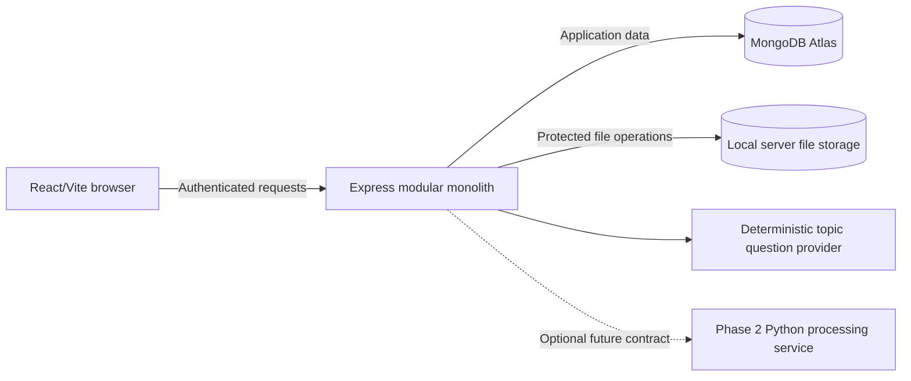

# Preliminary Architecture Plan

**Direction:** Modular Monolith + Future AI Service
**Requirements reference:** [Approved Working Baseline v1.0](REQUIREMENTS_BASELINE.md)
**Status:** Preliminary design planning; unresolved choices are not approved designs.
**Date:** 2026-11-17

## Purpose and boundaries

Organize the next architecture tasks without implementing features or selecting schemas,
authentication/session mechanisms, endpoints or deployment details. The approved Task 2
requirements and D-01 through D-03 constrain the design. Component boundaries below are
proposals to evaluate against them, not a completed architecture or additional formal approval.

The repository currently contains a React/Vite prototype with browser-local services and
fixtures. It has no Express application, Atlas integration or protected server uploads.
`AutoNote/` is preserved legacy source and must remain outside the Phase 1 runtime.

## Approved direction and proposed responsibilities

| Layer / component | Phase | Responsibility to design |
| --- | --- | --- |
| React/Vite presentation | Phase 1, existing foundation | Preserve screens, routing and core workflows; later connect an API-facing service boundary while clearly disclosing bank-based generation. Authentication UI remains to be designed. Keep `src/` in place for this task. |
| Node.js/Express application | Phase 1, not implemented | Real authentication, backend authorization, business rules, API handling and coordination of application persistence/file storage. |
| MongoDB Atlas | Phase 1, not integrated | Required application data for the logical entities in the baseline, including stable quiz/result snapshots and material file references. Collection/schema design is AD-02. |
| Protected local server storage | Phase 1, not implemented | Accepted file bytes, separated from public static assets and guarded by server-controlled access. Exact storage layout and delivery mechanism are unresolved. |
| Deterministic question provider | Phase 1, not implemented | Backend-managed predefined questions matched to supported topics; an implementation inside the monolith is proposed. Selection policy and provider contract remain open. |
| Optional Python processing service | Potential Phase 2 | Selected, validated AutoNote capabilities behind a replaceable interface; not required for Phase 1 startup, uploads, readiness, generation, grading or any other core workflow. |

### Proposed context and trust boundaries

The diagram is proposed direction, not a deployed topology. Only the Express boundary
should trust authenticated identity and authorized operations; browser roles, grades,
course IDs and filenames must be treated as untrusted input. Browser code must not receive
Atlas credentials or direct access to protected storage. Exact credential handling, request
transport and file-access contracts are AD-01/AD-03 decisions.

A **modular monolith** here means one proposed Express backend with internal responsibility
boundaries rather than separate Phase 1 network services per business feature. Candidate
modules are identity/access, materials, quiz generation, attempts/grading/practice, deadlines
and teacher result queries. These are design groupings, not approved folder names, classes
or database collections. The future AI service would be optional and separately validated.

## Requirement constraints for design

- D-01 / FR-01: registration/login must enforce server-controlled roles and preassigned
  memberships. Public requests cannot promote accounts to Teacher or self-enroll.
- D-02 / FR-02: real bytes go to protected local storage and application metadata to Atlas.
  The design must account for a file-write failure and a database-write failure without
  falsely reporting a valid ready upload. No particular transaction/cleanup strategy is chosen.
- D-03 / FR-03: Phase 1 readiness and matching cannot depend on semantic extraction. Show
  predefined-content disclosure. Keep generation replaceable without requiring Python.
- FR-04 / FR-05: preserve question/grading snapshots, one final result per Attempt and
  original records across practice. Concurrency and retry behavior need explicit design.
- FR-06 / FR-07: enforce Teacher permissions and course isolation at the backend; preserve
  calendar boundaries and exclude drafts from submitted-result views.
- NFRs: retain all original conditions in the baseline. In particular, do not remove the
  AI precondition from NFR-01 or claim current mock timing proves production compliance.

## Architecture work packages

These are subsequent design tasks, not work implemented by this documentation change.
Their deliverables and review questions are proposed; team member assignments and dates
remain open. Requirement definitions are not repeated here.

| Package | Deliverable to prepare | Required review evidence | Dependencies |
| --- | --- | --- | --- |
| AD-01 Component Architecture | Component/trust-boundary diagrams, module responsibilities, runtime/deployment assumptions and proposed optional AI boundary | Trace each component to FRs; show where identity/course/ownership checks occur, how files remain protected and how Phase 1 runs with no AI/Python | Baseline v1.0; feed constraints into AD-02/03 |
| AD-02 Data Model | Detailed fields, relationships, validation, storage representation, indexes, snapshot lifecycle and persistence/failure strategy | Cover all ten logical entities; demonstrate original-result immutability, membership enforcement, draft durability and one final result per Attempt; account for files plus Atlas | AD-01 responsibilities and baseline invariants; iterate with AD-03 |
| AD-03 API Contract | Operations, request/response/error semantics, authentication interface, file transfer, readiness, generation and submission behavior | Trace operations to ACs; specify unauthorized/invalid/failure/retry outcomes and ensure no client-controlled privilege or grade; document replaceable generation contract | AD-01 boundaries and AD-02 invariants; no route naming assumed now |
| AD-04 Implementation Plan | Reviewed increments, dependencies, migration from mocks, testing strategy and evidence/release gates | Assign AC-01 through AC-14 and NFV-01 through NFV-06 to verification work; identify AI-independent integration checks, NFR studies, rollback/recovery needs and scope decisions | Outputs of AD-01/02/03 plus resolution or explicit deferral of blocking questions |

AD-02 may select schemas and indexes later; this document does not. AD-03 may select session
or token contracts later; listing alternatives does not approve either. AD-04 should produce
a sequenced implementation plan only after contracts and invariants are sufficiently clear.

## Open design register

The canonical questions are in the [baseline](REQUIREMENTS_BASELINE.md#open-design-questions-and-change-control).
This table states what architecture work must resolve, without duplicating decisions.

| Baseline question | Design analysis needed | Decision still open |
| --- | --- | --- |
| Q-01 Authentication and provisioning | Evaluate session/cookie vs token options, expiry/logout/recovery, password-hash policy and trusted role/membership provisioning | No authentication mechanism, hashing algorithm/configuration or enrollment flow selected |
| Q-02 Material readiness | Define stored vs eligible/ready meaning without transcription or semantic extraction; decide trusted topic association and failure transitions | No state machine, queue or readiness timer selected |
| Q-03 Upload policy and storage | Define size/type/resource limits, validation and file access; assess path safety, local disk capacity, retention and cross-store recovery | No numeric upload limits, disk layout or file-serving endpoint selected |
| Q-04 Question matching | Evaluate topic sources, deterministic selection, bank maintenance, insufficient matches, quiz size and repeat generation/practice behavior | No tagging UI, matching algorithm, fallback or question count fixed |
| Q-05 Submission idempotency | Analyze duplicate/concurrent requests and lost responses across draft/final result persistence | No idempotency-key, locking, index or transaction design selected |
| Q-06 Drafts and recovery | Define save acknowledgement, reconnect behavior and competing sessions without losing selected answers | No autosave interval, conflict policy or client/server reconciliation protocol selected |
| Q-07 NFR verification | Resolve AI-dependent NFR-01 treatment and document timing boundaries/fixtures for performance checks | No new Phase 1 performance target or original requirement waiver approved |
| Q-08 Calendar semantics | Choose consistent date/timezone interpretation while keeping today through +7 inclusive and +8 unmarked | No timezone policy selected |
| Q-09 Authority and review process | Agree a shared M2 source location and how decisions/baseline changes are recorded | No new approval authority or team sign-off inferred |
| Q-10 Future AI integration | Evaluate provider contract, synchronous/asynchronous processing, output validation, privacy, costs, failure isolation and safe AutoNote reuse | No queue, provider/model, deployment protocol or AutoNote module selected |

## Future AI evaluation boundary

The [AutoNote import review](AUTONOTE_IMPORT_REVIEW.md) documents incomplete dependencies,
import-time execution, unsafe historical parsing/shell construction, inconsistent schemas
and credential-remediation follow-up. Keeping the source does not certify it as deployable.
Do not import or run it during Phase 1 setup or these architecture documentation tasks.

For a later Phase 2 proposal, compare candidates with synthetic fixtures and controlled
provider substitutes before approved live processing. Define input/output contracts and
privacy/cost controls before connecting real recordings or model APIs. Transcription,
structured notes and AI question generation remain potential enhancements. Keep core
identity, course rules, quiz ownership, grading snapshots and persistence within the
application's trusted business boundary; a provider must not decide authorization.

## Design handoff checklist

Before implementing a work package, review its requirement mapping and unresolved questions.
Document chosen mechanisms and tradeoffs separately from the baseline's required outcomes.
Changes to approved scope or original NFR conditions require an explicit recorded requirement
decision rather than an implicit architecture substitution.

Use the [traceability matrix](REQUIREMENTS_TRACEABILITY.md) to confirm that US-07 and all
five critical use cases remain represented. Preserve the current frontend workflows and
regression tests while later replacing mocks deliberately. This planning document creates
no backend, database schema, API endpoint, infrastructure resource or new dependency.
