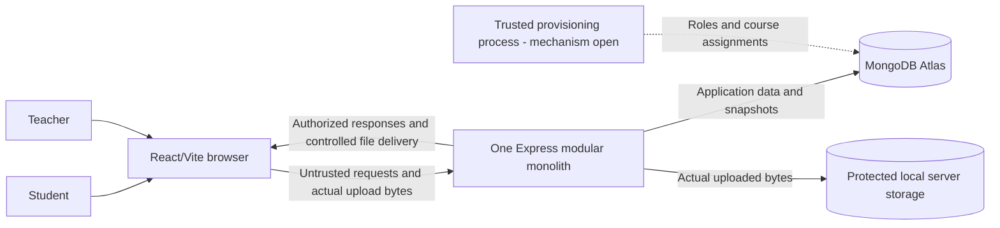
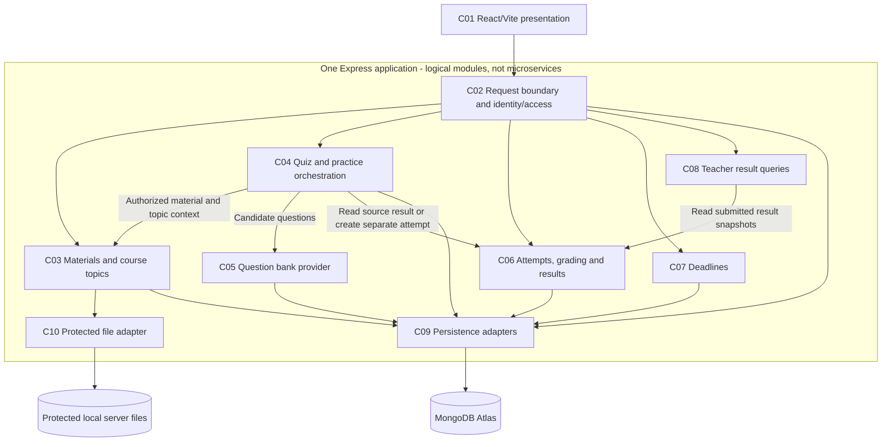

# AD-01 Component Architecture

| Document control | Value |
| --- | --- |
| Document version | 1.1 |
| Status | **Prepared for Review**; AD-01/AD-02 consistency revision, not implemented or formally approved as a whole |
| Date | 2026-11-17 |
| Requirements reference | [Requirements Baseline v1.2](REQUIREMENTS_BASELINE.md); Task 3 confirmations preserved and Task 4 refinements recorded in [AD-02](DATA_MODEL.md) |
| Inspected repository | `e310d1b` before this documentation-only change |

> Subsequent refinement (Task 6, 2026-11-18): [AD-03 decisions AD03-D01 through D10](API_CONTRACT.md#1-confirmed-decisions-and-review-boundary)
> now confirm cookie sessions/trusted provisioning, synchronous upload, generation replay,
> Start-time Attempt creation, Regular-only practice sources, course-configured IANA calendar
> policy, revision conflicts and CSRF/Origin/error behavior. Earlier open/proposed wording
> below records the AD-01/AD-02 review stage; those decisions are preserved. Exact mechanisms
> remain proposed/open in AD-03; no formal team approval is asserted.

## 1. Purpose, authority and scope

Describe a **modular monolith** that preserves the existing study workflows while moving
trusted business operations to Express. This is component design for review, not executable
code, a schema, an API contract or a deployment specification. No packages are installed,
source/tests changed or AutoNote modules executed by this task.

Authority is the original Milestone 2 report, Task 2 requirements, four confirmed Task 3
decisions below and six confirmed Task 4 refinements in [AD-02](DATA_MODEL.md#1-sources-and-decision-authority).
AD-01 originally checked M2 provenance; Task 4 additionally inspected M2/M3 content and
original diagrams, with findings in the [milestone audit](DATA_MODEL.md#2-milestone-consistency-and-design-evolution).
This revision does not assert formal team approval. Original requirement IDs and numerical
NFR conditions remain unchanged.

The [README](../README.md), historical Milestone 3 assumptions (team-local archive),
[traceability matrix](REQUIREMENTS_TRACEABILITY.md), [architecture plan](ARCHITECTURE_PLAN.md),
[AutoNote review](AUTONOTE_IMPORT_REVIEW.md), [mock services](../client/src/services/demo.js),
[fixtures](../client/src/data/fixtures.js) and existing [service](../client/tests/services.test.js) and
[browser tests](../client/tests/browser.mjs) describe the current prototype and its limits.
React/Vite is implemented; the Express, Atlas and file-storage behavior below is future work.

**Status vocabulary:** Confirmed means explicitly supplied in Task 3/Task 4 (or an unchanged
baseline requirement). Proposed means an evaluated design recommendation awaiting review.
Open means no mechanism/policy is selected. Completing this design document does not approve
its proposals. AD01-D identifiers intentionally preserve the supplied gaps; no D03/D04 or
D06-D08 decisions are invented.

## 2. Confirmed architecture decisions

| ID | Confirmed decision | Requirements implications |
| --- | --- | --- |
| AD01-D01 | Users manually select from predefined course-specific topics; a material may have multiple topics. The backend validates topic/course associations. No semantic analysis of uploaded files; clearly disclose predefined questions. | FR-02/03 and AC-02/04/05; topic source in Q-02/Q-04 resolved. AD02-D03 now confirms at least one Topic at upload; editing policy remains open. |
| AD01-D02 | Server-controlled Student/Teacher roles and trusted preassigned memberships. Public registration cannot grant Teacher or arbitrary course access. Backend authentication, authorization and ownership checks; no enrollment-administration UI. | FR-01 and all protected workflows; clarifies Q-01 provisioning authority, not its implementation or authentication mechanism. |
| AD01-D05 | Every successful regular quiz contains exactly 10 distinct eligible questions from the backend-managed course/topic bank. Fewer than 10 fails clearly, without a partial Quiz or invalidating the stored material. | FR-03, AC-04/05; regular quiz size and insufficient-bank behavior in Q-04 resolved. |
| AD01-D09 | Targeted practice has 1-10 distinct eligible questions on missed topics, excludes source-quiz questions and requires at least one eligible question. Perfect results produce none. Separate linked records preserve the original Quiz, Attempt, answers and Result. | FR-05, AC-07/08; practice bounds and empty-pool behavior resolved, exact sizing/selection within the range remains open. |

The exactly-10 rule applies to **regular quizzes**, not targeted practice. It does not
remove NFR-01's working-AI-service precondition or prove compliance with that original NFR.

## 3. Phase 1 system context

The browser has no direct Atlas connection, database credentials or public filesystem
access. Trusted provisioning is an operational responsibility, not a public user role or
new administration UI. Its execution method is not finalized. Server-side sessions/cookies
are a proposal; no authentication transport is implied by the diagram.

Phase 1 requires the Node application, Atlas and protected local storage, but no Python,
Whisper, LLM keys or external AI service. AI independence does not mean offline Atlas support.

## 4. Component architecture

Arrows indicate logical dependencies/calls, not internal HTTP endpoints or independent
processes. Each workflow establishes an authorized principal at C02; resource-aware checks
are also applied by the owning module through the shared access policy before reads/writes.
C09's shared infrastructure box does not transfer business ownership to a generic data layer.
Authentication, provider and adapter interface signatures are AD-03 work, not defined here.

### Component responsibility matrix

| Component | Owns / accountable behavior | Collaborates with | Does not own |
| --- | --- | --- | --- |
| C01 Presentation | Existing screens/navigation, topic-selection UI to be designed later, upload/eligibility/predefined-content feedback, draft/retry display | C02 through future API contract | Authority over roles, grades, persistence success or protected file paths |
| C02 Request boundary and identity/access | Register/login handling, password-verification boundary, trusted principal, shared role/membership/ownership policies, input/error boundary | C09 for identities/assignments; C03-C08 for resource context | Quiz selection, grading, Teacher self-assignment or client-controlled memberships |
| C03 Materials and course topics | Material acceptance, upload coordination, persisted file references/status, validation of selected topics against the course, authorized material/file access | C02 policy, C09 metadata/topic catalog, C10 bytes | Semantic extraction, question-bank sufficiency policy, Quiz/Result writes |
| C04 Quiz and practice orchestration | Generation eligibility, course/topic/exclusion context, count/distinctness checks, immutable Quiz snapshots, linking practice to source Result, coordinating separate Attempt creation | C02, C03, C05 candidates, C06 result reads/attempt creation, C09 Quiz persistence | Password policy, source-result mutation or grading |
| C05 Question bank provider | Read backend-managed question content/tags; return eligible distinct candidate content under reviewed selection policy | C09 for bank data | Authentication, grading, Quiz/Attempt/Result writes or final success reporting |
| C06 Attempts, grading and results | Attempt creation and draft lifecycle, answer validation, backend grading using Quiz snapshots, one final Result per submitted Attempt, immutable result read interface | C02 policy, C09; receives trusted snapshot context from C04 | Selecting new quiz questions or changing a completed source result during practice |
| C07 Deadlines | Teacher-authorized validation/create/edit/delete, student date filtering and Upcoming computation shared by dashboard/list | C02 policy, C09 | External notifications, course enrollment or result writes |
| C08 Teacher result queries | Assigned-course submitted-score/answer view, exclude drafts and prevent cross-course list/direct-read exposure | C02 policy and C06 read interface | Grading again, editing results or directly mutating persistence |
| C09 Persistence adapters | Encapsulate Atlas I/O and later-selected consistency primitives under domain-owner instructions | Domain owners above | Independent business decisions, authorizing an unchecked request or defining collection schemas here |
| C10 Protected file adapter | Controlled byte storage/read/cleanup using server-owned references | C03 coordinator | Public static publishing, authorization by filename alone or Atlas material-status decisions |

Only C04 writes Quiz state, C06 writes Attempt/Result state, C03 coordinates material
metadata/bytes and C07 writes deadlines. C08 is a read-only projection of C06 results.
C05 supplies content; C04 validates its output and owns the generation outcome. C09/C10
execute persistence operations on behalf of these owners. Final cross-owner atomicity and
failure handling are AD-02/AD-03 work. Trusted provisioning may populate accounts, courses,
memberships, topic catalogs and bank content outside public workflows under reviewed controls.

## 5. Authentication, authorization and trust boundaries

- Establish identity on the backend. A request's user/role/course fields never grant rights.
  Public registration cannot promote an account or create arbitrary membership (AD01-D02).
- C02 supplies reusable access policy; each domain owner verifies the loaded resource's
  course and owner, not just a request URL/course parameter. Check list filtering and
  direct-object access. C08 needs Teacher assignment; C06 Student operations need ownership.
- Both Students and Teachers can upload in assigned courses. Students generate/answer their
  own quizzes. Teacher access to submitted answers is deliberate and course-limited;
  it does not grant access to drafts as submitted results.
- Browser file names, topic IDs, grades and answers are untrusted. C03 checks every selected
  topic belongs to the material's course. C06 grades trusted stored snapshots rather than
  accepting a client score. Preview serialization must not expose private grading keys.
- Protected file content must pass through server-controlled access; internal disk paths
  and Atlas credentials must not be exposed. Local storage must not be mapped as an
  unrestricted public directory. File-access/retention details remain open.
- Secure password hashing is a baseline obligation. Session vs token, hash parameters,
  expiration, logout/recovery and cookie/CSRF policy are unresolved (Q-01 / P-08 below).

These boundaries are for the future backend. Existing demo controls and browser guards
are not equivalent enforcement or a production security audit.

## 6. Upload and manual topic association

**Confirmed:** actual bytes on the server, metadata in Atlas, assigned-course upload,
manual selection from predefined course-specific topics, multiple-topic support and backend
association validation. AD02-D03 requires at least one Topic at upload. A material's validity
is not lost because its question bank is small.

**Confirmed business rule:** upload includes at least one selected course Topic (AD02-D03).
P-01 still proposes a combined transport request; multipart details, status codes and
interruption handling remain AD-03 proposals. P-02's minimum-count rule is now confirmed.

1. C01 presents topics from the selected course and clearly explains predefined questions.
2. C02 authenticates the actor; C03 checks membership, file policy and topic/course validity.
   A forged foreign-course topic must not become an accepted association.
3. C03 coordinates C10 storage of bytes and C09 persistence of the material information.
   Only consistent completed storage may be reported as stored successfully. Failures need
   clear feedback and no falsely valid record; cleanup/reconciliation ordering is proposed in AD-02, awaiting review.
4. C01 displays storage outcome separately from generation eligibility (P-03). C04 may
   assess coverage through C05 (P-04); its result is not proof of content understanding.
5. A generation request rechecks current access, material/topic context and bank coverage.
   A previously shown eligibility hint must not bypass the backend's final checks.

Empty Topic selection is not accepted at upload; later editing rights and changes remain
open. [AD-02 storage lifecycle](DATA_MODEL.md#6-proposed-material-storage-lifecycle-and-recovery)
proposes recovery without treating pending/failed intents as successfully stored materials.
No new input screen is implemented here;
existing UI-02/UI-03 are the workflow references for later design, not evidence of a current
manual topic selector.

## 7. Storage/readiness versus quiz eligibility

P-03/P-04 recommend separate storage facts and derived generation eligibility. These
concepts are **not database enums or a finalized state machine**.

| Situation | Storage interpretation | Regular generation outcome |
| --- | --- | --- |
| Missing/rejected bytes or incomplete storage | No successful valid stored material | Fail; no Quiz |
| Missing or foreign-course Topics during upload | Reject the complete association under AD02-D03; no valid stored material | No Quiz; later association corruption/retirement needs recovery policy |
| Stored successfully; valid topics; fewer than 10 distinct eligible regular questions | Material remains valid/stored (AD01-D05) | Clear insufficient-bank failure; no partial Quiz; no need to upload bytes again |
| Stored successfully; valid topics; at least 10 distinct eligible regular questions | Storage unchanged | Authorized request can create exactly 10 distinct question snapshots |
| Bank or topic policy changes after an earlier check | Storage success alone is insufficient evidence of current eligibility | Re-evaluate under reviewed policy; existing Quiz/Result snapshots stay unchanged |

At least one selected course Topic at upload is confirmed; exact state representation and
later topic-change handling remain proposals. The confirmed lower bound of 10 for regular quizzes is not a minimum upload-validity condition.
Materials must not be relabeled corrupted/unusable solely because no matching questions
exist. Future AI processing status must likewise not retroactively redefine Phase 1 storage
success or gate its core workflows.

## 8. Question bank and quiz generation

C04 orchestrates; C05 supplies candidates; C04 enforces the final result invariants.

### Regular quiz

1. Verify Student identity, course access, material context and validated selected topics.
2. Request course-specific, topic-matched candidate questions. Deduplicate stable question
   identities before counting; multiple matching tags must not multiply one question.
3. If fewer than 10 distinct eligible questions exist, return an explained failure, with
   no partial Quiz and no change to material validity (AD01-D05).
4. Otherwise select exactly 10 under the reviewed policy, validate provider output and
   persist Quiz snapshots. Preview questions and choices before Start. AD-02 proposes
   creating the sole owned Attempt through C06 on Start; timing awaits AD-03 review.
5. Report success only when the required records are durably consistent. A persistence or
   provider failure must not leave a usable partial quiz. Generation-request retry handling
   is proposed in P-05, not yet a finalized creation policy.

AD02-D04 confirms matching selected Topics with favored coverage; empty Topics can be
compensated by other selected Topics. Exact balancing, ordering and tie-breaking remain
P-06/Q-04 proposals in AD-02. No cross-course fallback or semantic analysis is implied.
A deterministic policy may return the same questions on intentional regeneration; distinct
questions within one quiz does not imply freshness across all historical quizzes.

### Targeted practice

C04 reads the authorized **original graded Result** through C06. It obtains missed topics
from the preserved result/quiz context, not from a mutable current bank's changed topic tags.
A perfect result produces an explanation and no practice records. Otherwise candidates must
be course-appropriate, focus on those missed topics and exclude every question in the source
quiz by stable identity; deduplicate before selection.

With zero eligible distinct questions, fail without creating practice. With one or more,
a successful practice contains **1-10 distinct questions**, never more than are eligible,
with separate Quiz and Attempt records linked to the original Result (AD01-D09), and
its own Result after successful submission; no practice Result exists beforehand. Selecting
all candidates up to ten is only a possible sizing policy, not a confirmed requirement.
Requiring ten practice questions would contradict AD01-D09. Excluding questions from other
previous practice sessions, allowing practice-of-practice, and handling edited/retired bank
items remain explicit Q-04 questions. The current prototype uses the original lecture
result as the source; no new practice-of-practice behavior is approved here.

### Replaceable provider boundary

D-03 already requires replaceability. P-07 proposes an internal question-provider abstraction
shared by regular/practice generation. Conceptually, C04 supplies validated course/topic
context, exclusions and required count/bounds; C05 supplies candidate content or an explained
failure. This is not a DTO or API signature. C04 retains count/identity checks, authorization,
snapshots and persistence control when the provider changes. The provider never grades,
creates final Results or authorizes access.

## 9. Quiz, Attempt, Result and practice lifecycle

| Concept | Lifecycle responsibility / invariant | Unresolved implementation detail |
| --- | --- | --- |
| Quiz | C04 creates a persisted regular/practice question snapshot for an authorized Student. Preview uses this snapshot; later bank edits do not change historical questions or grading meaning. | Snapshot fields/versioning and generation retry identity in AD-02/03 |
| Attempt | C06 owns the at-most-one Attempt per Student-owned Quiz; missing/invalid answers retain the draft, submitted Attempts never reopen/overwrite (AD02-D05). | Start-time creation proposed in AD-02; autosave acknowledgement/conflict policy remains open |
| Result | C06 grades trusted snapshots and persists one final result per submitted Attempt, with submitted answers, feedback, score and timestamp. | Atomic finalization, concurrency control and response replay |
| Targeted practice | C04 creates a new Quiz linked to the source Result; C06 creates its own Attempt and its own Result only on successful submission. All three are independent of original records. | AD-02 proposes sourceResultId, Start-time Attempt and atomic submission; review with AD-03 |
| Original record set | Source Quiz, Attempt, answers and Result/score remain unchanged after practice creation/completion. | Retention/deletion handling without breaking historical references |

No state transitions or ownership rules authorize overwriting a submitted Attempt to reuse
it for practice. AD02-D05 requires a new Quiz for deliberate new learning and preserves
all prior Quiz/Attempt/Result records, intentionally changing M3's latest-score-only retake
assumption. A practice source link is not the practice Result. Creation and grading preserve
history; read views do not regrade against the live bank. An incomplete/failed operation must not be presented as a completed Result.

## 10. Retry, duplicate submission and historical invariants

| Invariant | Owner | AD-02/AD-03 obligation |
| --- | --- | --- |
| Exactly one final Result per submitted Attempt | C06 | Choose concurrency-safe finalization/persistence semantics; prove simultaneous submissions cannot produce two Results |
| Retry after committed submission/lost response preserves the original result | C06 | Reconcile existing completion and return its outcome without a new grade/timestamp; distinguish failed validation from unknown completion |
| Saved draft and same-session reconnect retain selections | C06 + C01 | Define acknowledged saves, in-flight/offline selections and reconciliation under NFR-06; a timeout is not evidence that the server did nothing |
| Quiz and grading snapshots retain historical meaning | C04/C06 | Define stable identity/versioning, snapshots and allowed writes without depending on later bank contents |
| Practice never modifies the original record set | C04/C06 | Create separate records, preserve source links and test the full original set before/after |
| Generation retry versus intentional regeneration | C04, AD02-D05 plus proposed P-05 | Deliberate new learning creates a new Quiz; retry identity/deduplication remains a proposed AD-02/AD-03 mechanism |

Submission uniqueness is a confirmed baseline outcome. Generation-request deduplication
remains a proposal, while new Quiz identity for deliberate learning is confirmed by
AD02-D05. They are distinct operations. AD-02 proposes unique indexes, conditional updates
and transactions; no idempotency header, lock or transaction scheme is approved. Retrying
with conflicting answers after finalization must not change the final
result; exact response semantics remain AD-03. NFR-06's real network-drop/reconnect test
is still required; the prototype's simulated interruption does not demonstrate it.

## 11. Deadlines and Teacher result review

C07 alone owns deadline writes. It checks assigned Teacher rights and title/type/date
validation before create/edit/delete. Teachers may manage past dates. Its shared student
projection serves UI-01 and UI-08: past dates hidden; today through day +7 inclusive marked
Upcoming; day +8 and later visible without that label. Edits/removals must not leave stale
reminders. Only in-app reminders are in scope. Calendar timezone and cache/refresh semantics
remain Q-08/AD-03; AD02-D06 confirms YYYY-MM-DD date-only values rather than cutoff
timestamps. Alerts remain derived; no notification service or persistent Alert entity is added.

C08 provides UI-01T's assigned-course submitted-result view through C06, after C02 policy
checks. Exclude drafts and deny unassigned-course list/direct-result requests. Teachers
review preserved scores/answers; C08 does not grade, mutate Results or provide advanced
analytics. Student result views use C06 with ownership checks. This keeps US-07 explicit
without inventing a sixth original critical use case.

## 12. Atlas and protected local storage boundaries

Atlas holds the ten baseline logical entities' application data, including membership,
material references, topics/questions and historical quiz/attempt/result context. These
are logical responsibilities, not a one-entity-per-collection schema decision. C09's design
must support authorization lookups and domain invariants; fields, indexes, relationships,
embedding and transaction choices are proposed in [AD-02](DATA_MODEL.md), not implemented.

C10 stores actual file bytes under server-controlled paths outside unrestricted public
assets. C03 binds the stored object to its material/course/owner metadata and authorizes
retrieval. The browser cannot choose arbitrary filesystem paths or use a raw path as proof
of access. No direct browser-to-Atlas or browser-to-local-disk credentials are required.

Filesystem operations and Atlas writes are separate failure domains. An Atlas transaction
cannot by itself make a local file write atomic. AD-02 must define recovery for a stored
file with failed metadata, metadata with missing bytes and interrupted cleanup; AD-03 must
specify observable pending/failure/retry behavior. Upload limits, retention, backup/restore,
server disk portability and deployment topology remain Q-03. No production data or resources
are created by this design.

## 13. Optional Phase 2 boundary

No Phase 1 component calls AutoNote to establish material validity, choose questions or
grade answers. A future provider adapter/processing boundary may request validated Python
transcription, note generation or AI questions. It remains optional, with output validation
and C04/C06 ownership of application invariants. Python does not own account permissions,
course membership or final grading history.

The [AutoNote review](AUTONOTE_IMPORT_REVIEW.md) identifies incomplete dependencies,
import-time work, unsafe historical parsing/shell use and inconsistent data shapes.
Preservation is not deployment approval. Future service transport, jobs, timeouts, privacy,
cost controls and safe component selection remain Q-10; no queues, model or service endpoints
are selected here. Existing Phase 1 behavior must still work with Python absent and AI
unavailable (AC-12). NFR-01 still requires the original working-AI-service test condition;
meeting the confirmed ten-question count alone cannot satisfy it.

## 14. Requirements and verification traceability

Component IDs are AD-01 labels, not original requirements. AC/NFV scenarios remain proposed
verification work; no backend tests are implemented or claimed passed here.

| Functional requirement | Original scope | Primary domain owner and collaborators | Existing UI / proposed verification |
| --- | --- | --- | --- |
| FR-01 Authentication/course access | Supports all UCs/USs; no new original UC/US | C02; resource owners C03/C04/C06/C07/C08 enforce policy on loaded context | All screens; authentication UI undesigned; AC-01/11, NFV-03 |
| FR-02 Material upload | UC-01 / US-01 | C03 with C02, C09, C10 | UI-01/02/03; AC-02/03; foreign-course tags and storage failure |
| FR-03 Regular quiz generation | UC-02 / US-02 | C04 with C03, C05, C06, C09 and C02 policy | UI-03/04; AC-04/05; eligible counts 9, 10, 11; no partial Quiz or material invalidation |
| FR-04 Submission/feedback | UC-03 / US-03 | C06 with C02, C09, C01 | UI-04/05; AC-06/11; concurrent retry, stale bank and lost-response cases; NFV-06 |
| FR-05 Targeted practice | UC-04 / US-04 | C04 with C05, C06, C09 and C02 policy | UI-05/06/04; AC-07/08; eligible counts 0, 1, 9, 10, 11; source exclusions and immutable originals |
| FR-06 Deadlines | UC-05 / US-05 and US-06 | C07 with C02, C09, C01 | UI-07 -> UI-01/08; AC-09/11; days -1, 0, +7, +8 and removal |
| FR-07 Teacher review | US-07; no dedicated critical UC | C08 with C02 and C06 | UI-01T via UI-01; AC-10/11; drafts and unassigned courses excluded |

For a regular pool of 9, fail; with 10 or 11, a successful quiz has exactly 10 distinct
questions. For practice, 0 fails; every successful case with a positive pool has 1-10
questions and cannot exceed the pool size. No exact practice count is assumed until the
sizing proposal is reviewed. Also test duplicate candidate identities and questions matching
multiple tags; count unique questions, not topic matches. Failed generation never invalidates
an otherwise valid stored material.

| Original NFR | Component responsibility / evidence boundary |
| --- | --- |
| NFR-01 | C04/C05 provider timing; retain original 30-slide, 18-of-20, 10-question, 30-second, one-user and working-AI-service conditions in the baseline. Phase 1 is not proof of compliance. |
| NFR-02 | C06/C08/C09 result reads; preserve original dataset, timing and environment in the baseline; no production benchmark claimed. |
| NFR-03 | C02 plus domain owners deny prohibited Student actions and private-answer access; browser guards alone are insufficient. |
| NFR-04 | C01 with C03/C04/C06 supports the original first-time-user task; the five-user study is separate from automation. |
| NFR-05 | C01 supports keyboard-only upload/answer/submission and visible focus; native chooser verification remains necessary. |
| NFR-06 | C01/C06/C09 preserve answers through same-session disconnect/reconnect and reconcile ambiguous submission completion. |

AC-12 verifies operation without AI; AC-13 preserves frontend workflow paths; AC-14 plans
automated critical success/failure coverage. The [full matrix](REQUIREMENTS_TRACEABILITY.md)
retains the original screen/story mappings without declaring current mock tests sufficient.

## 15. Proposal evaluation and unresolved design handoff

### Proposal register and confirmed promotions

| Proposal | Evaluation / recommendation | Tradeoff or unresolved point |
| --- | --- | --- |
| P-01 Submit file, course and topics together | Recommended for a coherent upload context and early course validation | Request format, interrupted upload behavior and later topic editing remain AD-03/AD-02 decisions |
| P-02 Require at least one selected topic | Business rule promoted to Confirmed by AD02-D03: at least one predefined course Topic at upload | Transport details and later Topic edits remain open; empty selection is not accepted |
| P-03 Separate storage success from readiness/eligibility | Recommended to keep storage truthful; required outcome is that insufficient questions do not invalidate a material | Exact labels/state transitions and whether eligibility is derived or persisted remain open |
| P-04 Eligibility uses valid topics and sufficient bank coverage | Recommended, with generation-time recheck | Full predicate, topic editing, removed topics and coverage feedback remain open; regular/practice count bounds are already confirmed |
| P-05 Intentional regeneration plus retry deduplication | Recommended to distinguish a deliberate new quiz from a retransmitted request | AD02-D05 confirms new Quiz identity for deliberate learning; operation identity, conflicts and recovery remain proposals |
| P-06 Deterministic, testable selection with reasonable topic coverage | Recommended for reproducibility and predictable tests | AD02-D04 confirms selected-Topic matching and favored coverage with compensation; exact quotas/order/ties, practice sizing and repeated-practice reuse remain unresolved |
| P-07 Internal replaceable question-provider interface | Recommended implementation of the already confirmed D-03 replaceability outcome | Exact input/output contract, provider error taxonomy and future AI adapter remain AD-03 work |
| P-08 Server-side sessions with secure cookies | Candidate preference for review, with server-controlled identity and revocation | Assess CSRF protection, session store/expiry, cookie attributes and deployment origins against token alternatives; authentication mechanism remains open |
| P-09 Trusted repeatable fictional seed scripts | Recommended for reproducible development accounts/courses/memberships/topics/questions | Review update/idempotency rules, environment isolation and credential injection; never ship fixed real credentials or make provisioning public |

### Open questions and AD-02/AD-03 handoff

| Baseline question / status | Resolved by confirmed decisions | Remaining design and recipient |
| --- | --- | --- |
| Q-01 partially resolved | AD01-D02 fixes trusted role/membership authority and no self-enrollment | AD-02 identity/provisioning persistence; AD-03 registration association, session/token choice, expiry/logout/recovery and request identity |
| Q-02 partially resolved | AD01-D01 fixes manual course-topic source; AD01-D05 forbids bank-shortage invalidation | AD-02 storage/association lifecycle; AD02-D03 settles timing/minimum; AD-03 resolves edit rights and feedback; AD-02 storage/recovery proposals await review |
| Q-03 open | Protected local bytes + Atlas metadata remain baseline constraints | AD-02 cross-store consistency/retention/backup; AD-03 limits, type validation, protected file transfer and failure behavior |
| Q-04 partially resolved | AD01-D05 fixes exactly 10 regular questions; AD01-D09 fixes practice bounds, exclusions and empty/perfect handling | AD-02 stable identity/snapshots/bank revisions; AD02-D04 settles matching/coverage direction; AD-03 resolves exact balancing, practice size/repetition and edited/deleted material/topic effects |
| Q-05 open mechanisms | One final Result per submitted Attempt remains mandatory | AD-02 concurrency/persistence guarantees; AD-03 conflicting retries, lost-response recovery and separate proposed generation deduplication |
| Q-06 open | Original NFR-06 retained | AD-02 draft durability/conflict representation; AD-03 save acknowledgements and same-session reconnect reconciliation |
| Q-07 open | Exactly 10 regular questions does not resolve AI-dependent NFR-01 | AD-04 and a recorded requirements decision must address phase applicability and original measurement protocol |
| Q-08 open | Existing day 0/+7/+8 visibility rules retained | AD02-D06 settles date-only representation; AD-03 resolves specific calendar timezone and refresh semantics |
| Q-09 open | Original PDF source and hash preserved in baseline | AD-04/shared requirements process must establish team access and revision review records |
| Q-10 open | Optional future AI cannot gate Phase 1 | AD-02 future processing references if needed; AD-03 provider/processing contract and privacy/failure isolation; no AutoNote integration selected |

### Inconsistencies and risks found

1. Baseline v1.0 left topic source and quiz size open. Revision v1.1 records the four confirmed
   decisions; baseline v1.2 adds the six AD-02 confirmations without approving all proposals.
2. The current fixture bank has five regular plus two practice questions per topic and
   selects all course topics. Under the confirmed manual single-topic path and unchanged pool
   policy, five regular questions cannot satisfy the new ten-question rule. Future bank
   preparation must address coverage; no fixture/source change is made here.
3. Topic selection is absent from the current upload UI. The new requirement needs later
   UI/API implementation; preserving current workflows does not mean it already exists.
4. Distinctness across topic tags and bank versions needs stable identity rules. Selecting
   the same source question under a new tag/version must not silently bypass practice
   exclusions; AD-02 must define identity semantics and AD-03 test them.
5. Favored selected-Topic coverage is confirmed by AD02-D04; exact balancing and practice
   size remain proposed. Do not silently require
   ten practice questions, all missed topics in every small quiz, or new questions across
   every repeated practice session.
6. Atlas plus local files has no automatic cross-store atomicity. False-ready materials,
   orphan files and partial Quiz/Attempt creation need explicit recovery design.
7. Original content-based goals and AI-conditioned NFR-01 remain only partially addressed
   by the Phase 1 bank approach. Manual tags and ten questions do not prove file understanding
   or NFR compliance. Authentication/session mechanisms and remaining proposals need review.

### Review boundary

This deliverable completes the AD-01 component-design document for review. Only the supplied
confirmed decisions are recorded as confirmed; proposals and open questions remain so.
AD-02 is also Prepared for Review; AD-03 and design review must resolve the remaining
handoff items before corresponding implementation. Existing
source, tests, dependencies, AutoNote and original NFR provenance remain unchanged. Changes
are left in the working tree, without staging, committing or pushing, for user review.

### Revision history

| Version | Change | Status |
| --- | --- | --- |
| 1.0 | Task 3 component design and four confirmed decisions | Prepared for Review; existing uncommitted work preserved |
| 1.1 | Task 4 consistency update: six AD-02 refinements, independent practice Quiz/Attempt/Result, source audit links and explicit approval boundary | Prepared for Review; other proposals remain unapproved |
