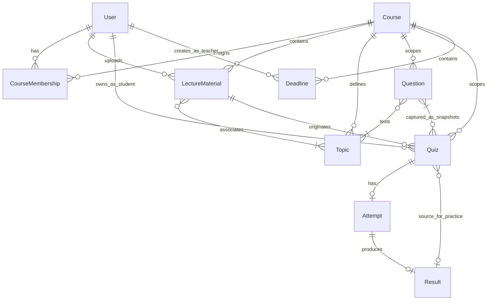

# AD-02 Data Model

> **Architecture handoff update (2026-11-24):** The team selected **Express → private Python AI HTTP service → Express validation/persistence** for planned US-01/02/03/05/06 delivery. This document preserves the earlier complete Phase 1 design and predefined Question Bank assumptions. The new [decision log](DECISIONS.md), [private AI protocol](backend/ai/PYTHON_HTTP_PROTOCOL.md) and [team API contract](contracts/HTTP_API.md) show proposed differences. Reconcile and approve changed requirements/contracts before implementation; no Express/Python/Atlas runtime integration is claimed.

| Document control | Value |
| --- | --- |
| Version | 1.0 |
| Date | 2026-11-17 |
| Status | **Prepared for Review** |
| Scope | Study Assistant Phase 1 logical model and proposed MongoDB/local-file persistence design; documentation only |
| Requirements authority | [Requirements Baseline v1.2](REQUIREMENTS_BASELINE.md), original M2 requirements, and explicitly confirmed Task 3/Task 4 decisions |
| Architecture reference | [AD-01 Component Architecture](COMPONENT_ARCHITECTURE.md); module boundaries remain design proposals |
| Repository inspected | `e310d1b` plus existing uncommitted AD-01 documentation, preserved by this revision |
| Approval boundary | Confirmed requirements constrain the design. Fields, collections, indexes, state names, algorithms and transaction protocols below are proposals, not implemented or formally team-approved. |

> Subsequent refinement (Task 6, 2026-11-18): [AD-03 decisions AD03-D01 through D10](API_CONTRACT.md#1-confirmed-decisions-and-review-boundary)
> now confirm cookie sessions/trusted provisioning, synchronous upload, generation replay,
> Start-time Attempt creation, Regular-only practice sources, course-configured IANA calendar
> policy, revision conflicts and CSRF/Origin/error behavior. Earlier open/proposed wording
> below records the AD-01/AD-02 review stage; those decisions are preserved. Exact mechanisms
> remain proposed/open in AD-03; no formal team approval is asserted.

## 1. Sources and decision authority

M2 and M3 were read from the local course workspace, outside the repository. PDF page
numbers below are one-based. Text extraction covered both reports; M3 PDF pages 2-3 were
also visually inspected for the context/Level 0/Level 1 DFDs and conceptual ERD.

| Source | Inspected evidence and role |
| --- | --- |
| `Project/Milestone/2/Team01- Milestone 2- Report.pdf` (5 pages) | Original requirements: actors and US-01 through US-07, pp. 1-2; UC-01 through UC-05, pp. 2-4; original NFR-01 through NFR-06, p. 4. SHA-256: `7b86a241c5bb7f5b33a84973f82d9b4f438071e1c1eab73fbaba3516c12d0070`. |
| `Project/Milestone/3/Team1-Milestone_3-Report.pdf` (11 pages) | Submitted design: DFDs pp. 2-3; ERD p. 3; business rules p. 4; UI workflows pp. 4-10; consistency table pp. 10-11. SHA-256: `29cc4abc75b6bbbf645b3ecea67bc6a0f855d3d571ec7a002af9ed65826a1970`. |
| [Baseline](REQUIREMENTS_BASELINE.md), [traceability](REQUIREMENTS_TRACEABILITY.md), [architecture plan](ARCHITECTURE_PLAN.md), [AD-01](COMPONENT_ARCHITECTURE.md) | Current phased scope, acceptance criteria, responsibilities and explicitly confirmed decisions. Neither architecture document implies formal approval of its proposals. |
| Historical Milestone 3 assumptions, archive, UI mapping and Phase A plan (held in the team's local archive) | Original prototype and milestone-design context, not current implementation authority. |
| [Mock services](../client/src/services/demo.js), [fixtures](../client/src/data/fixtures.js), [service tests](../client/tests/services.test.js), [browser tests](../client/tests/browser.mjs), [README](../README.md), [AutoNote review](AUTONOTE_IMPORT_REVIEW.md) | Inspected for current behavior and limitations. Browser-local state, fixture grading and simulated failures are not evidence of backend persistence or NFR compliance. AutoNote remains optional and unintegrated. |

The reports are not copied into the repository. Shared authoritative report access remains
Q-09. **Confirmed** below means explicitly supplied by the user, not inferred from an ERD,
a prototype, or a recommendation. **Proposed** means a design awaiting review. **Open**
means a policy or mechanism still needs a decision. No Mongoose schema, API, database
operation, seed, infrastructure, dependency or application/test change is part of AD-02.

### Confirmed AD-02 decisions

| ID | Status | Business requirement |
| --- | --- | --- |
| AD02-D01 | Confirmed | User has one backend-controlled global Student or Teacher role. CourseMembership is trusted assignment. Authorization combines role, course membership and resource ownership where applicable. Public registration grants neither Teacher privileges nor arbitrary membership. |
| AD02-D02 | Confirmed | Different terms or academic years of the same course code are separate Course instances. Memberships, materials, topics, questions, quizzes, results and deadlines are isolated by offering. The physical uniqueness key is still proposed. |
| AD02-D03 | Confirmed | Upload requires at least one manually selected predefined Topic of the selected Course; multiple Topics are allowed. The backend validates the entire association. Storage success does not guarantee quiz eligibility. No semantic topic extraction occurs in Phase 1. |
| AD02-D04 | Confirmed | A regular Quiz has exactly 10 distinct eligible questions from its Course matching the selected Topics, favoring coverage. A Topic with no candidates may be compensated by other selected Topics. Fewer than 10 overall fails clearly with no partial Quiz and no invalidation of stored material. Algorithm and tie-breaking remain proposals. |
| AD02-D05 | Confirmed | Each Quiz belongs to one Student and has at most one Attempt. Submitted Attempts cannot be reopened or overwritten. A deliberate new learning attempt creates a new Quiz; historical Quiz, Attempt and Result records persist. Practice uses independent linked records. |
| AD02-D06 | Confirmed | Deadlines use calendar dates `YYYY-MM-DD`, not cutoff timestamps. Today through +7 is Upcoming; +8 stays visible without the label; past dates are hidden from Students. A consistent course calendar timezone is required; the zone is unconfirmed. |

### Preserved AD-01 decisions

| ID | Status | Unchanged constraint |
| --- | --- | --- |
| AD01-D01 | Confirmed | Manual predefined course-specific Topic associations; multiple Topics, backend validation and disclosure; no semantic extraction. AD02-D03 settles upload timing and minimum count. |
| AD01-D02 | Confirmed | Trusted role/membership provisioning; no public privilege escalation, self-enrollment or enrollment-administration UI. AD02-D01 clarifies global role. |
| AD01-D05 | Confirmed | Exactly 10 distinct questions for a regular Quiz; insufficient bank yields no partial Quiz and does not invalidate stored material. |
| AD01-D09 | Confirmed | Practice contains 1-10 distinct eligible questions on missed topics, excludes source Quiz questions, requires at least one eligible candidate, and preserves the original linked records. Perfect scores produce no practice. |

These four IDs retain their original numbering gaps. Other AD-01 proposals remain proposals;
only their explicitly confirmed portions are promoted by the six AD-02 decisions.

## 2. Milestone Consistency and Design Evolution

AD-02 refines the submitted M3 conceptual design and discloses intentional changes. It does
not replace the original requirements with the current mock's behavior.

| M3 concept or relationship | AD-02 mapping | Refinement or change |
| --- | --- | --- |
| Student / Teacher | User with a global role | Consolidates identity attributes; preserves distinct permitted actions. A course assignment does not override the global role (AD02-D01). |
| Enrolls In / Teaches | CourseMembership plus role-aware authorization | Represents trusted assignment explicitly. M3 draws one Teacher to many Courses; the proposed membership model permits multiple assigned Teachers per offering. This relaxes that conceptual upper bound and needs review; it is not an additional confirmed staffing policy. |
| Course (including Term) | Course offering | AD02-D02 makes term/year isolation explicit. Course code alone cannot identify an offering. |
| Course File / Contains | LectureMaterial belonging to one Course | Adds real protected bytes, metadata and a recoverable storage lifecycle. |
| Concept / Yields | Topic and material-topic associations | **Intentional Phase 1 change:** M3 has Course Files yielding Concepts; predefined course Topics are manually selected at upload. Multiple materials may share Topics. No automatic content understanding is claimed. |
| Question / Tests | Question with one or more Topic references | M3 depicts a Concept testing many Questions. Proposed multi-topic tagging broadens that relationship and requires deduplication; it is a representation proposal, not an extra confirmed tagging policy. |
| Quiz / Generates / Has / Includes | Student-owned, course-scoped Quiz with immutable question/grading snapshots | M3 puts Questions in a Quiz; a reusable bank plus frozen occurrences preserves the displayed content and later grading. A bank Question may appear in several distinct Quizzes. |
| Takes, Score, DateTaken | Attempt and Result | Splits draft answers/finalization from immutable grade/feedback. **Intentional retake-policy change:** M3 p. 4 keeps only the most recent score on retake; AD02-D05 creates a new Quiz for a new learning attempt and retains all historical Quiz/Attempt/Result records. These policies are not identical. |
| Deadline / Sets | Deadline with Course and Teacher creator | Refines course ownership, date-only semantics and current assigned-Teacher authorization. |
| Alerts (business rule) | Derived deadline visibility and Upcoming projection | Preserves M3 p. 4: no separate persistent Alert entity or collection. Edits, removals and calendar changes recompute the view. |

**Teacher results:** M3 p. 4 and UI-01T (pp. 9-10) restrict Teachers to their assigned
courses; the UI excludes drafts. FR-07 preserves both rules. Having a Teacher role alone
is insufficient. Students see only their own private answers/results.

**Original generation goal:** M2 US-02/UC-02 expect questions derived from actual lecture
content. M3 DFD input is Course Concepts; its UI explicitly discloses sample data. Phase 1
uses selected Topics and a predefined bank, an intentional staged limitation. It does not
satisfy the full content-understanding goal or establish compliance with AI-dependent
NFR-01. Exactly ten questions does not remove that NFR's other original conditions.

**Deadline discrepancy:** M3 p. 1 suggests colors including overdue red, while its UC-05
workflow and later baseline specify the Upcoming display. Task 2 and AD02-D06 now govern:
past dates are hidden in Student views. An overdue Student color display is not silently
adopted; Teachers may still manage past entries. No new color scheme is specified here.

### DFD and UI continuity

| Submitted M3 flow | AD-02 data and AD-01 owner | Preserved UI/workflow |
| --- | --- | --- |
| 1 Submit Course Material; D1 Course Info | C03/C10 coordinate LectureMaterial bytes/metadata and manual Topic associations | UC-01, UI-01/02/03: validation, upload, truthful status; topic input still needs implementation |
| 2 Generate Quiz; Level 1 2.1 Generate Quiz, 2.2 Create Answer Choices, 2.3 Display Quiz; D1 to D2 Quizzes | C04/C05 select bank questions and persist a complete Quiz snapshot; Phase 1 obtains existing choices rather than generating semantic content | UC-02, UI-03 preview before UI-04 Start; no invalid Quiz after failure |
| 3 Take Quiz; D2 to D3 Results | C06 saves Attempt drafts, grades snapshots and commits Result | UC-03, UI-04/05: missing-answer feedback, reconnect and saved corrections |
| 4 Practice Topics; D3 to D2 and new D3 result | C04 reads source Result via C06, creates separate Quiz; C06 owns its Attempt and later Result | UC-04, UI-05/06/04/05: return to unchanged original; perfect-score exit |
| 5 Course Deadlines / 6 View Alerts; D4 Deadlines | C07 persists Deadline and derives alerts | UC-05, UI-07 and UI-01/08, US-05/06: edits/removals and date-window refresh |
| View Quiz Results in Level 0; UI-01T | C08 reads submitted Result/Attempt/Quiz context through C06 | US-07 assigned-course results; no invented sixth critical UC |

D1-D4 are conceptual stores, not mandatory collection names. M3's consistency table uses
User/LectureMaterial/QuizResult while its ERD uses Student/Teacher/Course File/Takes;
this naming difference is reconciled above. Authentication/membership checks apply across
the flows even though the original DFD does not detail a session mechanism.

## 3. Logical entities and proposed fields

The following are ten logical entities. **All field names, types and physical requiredness
are proposed.** Confirmed business invariants are identified separately. `ID` is an opaque
stable identifier (MongoDB ObjectId is a candidate, not a commitment); `Instant` is a UTC
instant; `CalendarDate` is a valid `YYYY-MM-DD` date. R = required, O = optional, C = required
under the stated condition. Every entity proposes `id: ID (R)` and `createdAt: Instant (R)`.
Mutable entities also propose `updatedAt: Instant (R)`. Timestamps never replace Deadline dates.
References denote relationships, not automatic foreign keys. C02 enforces access policies;
C09 is the persistence adapter, not the business owner. No public course/bank/provisioning
administration UI is introduced.

### 3.1 User

| Proposed field | Type | Presence | Meaning / validation |
| --- | --- | --- | --- |
| displayName | String | R | Nonblank display identity; not a permission source |
| email, normalizedEmail | String | R | Validated address and canonical lookup value; normalization policy must be reviewed |
| passwordHash | String | R | Secure password hash, never plaintext; algorithm/configuration unresolved |
| role | Student or Teacher | R | Single backend-controlled global role (AD02-D01) |
| accountState | active or disabled | R | Proposed access revocation control, not a new product role |

**Ownership/relationships:** C02 owns identity; trusted provisioning assigns role. One User
has zero or more CourseMemberships and may upload materials. Only Students own Quizzes;
only assigned Teachers create Deadlines. No per-course role field may grant privileges
inconsistent with User.role. Public registration cannot choose Teacher or memberships.
Role changes and historical attribution require trusted review; historical owners persist.

### 3.2 Course

| Proposed field | Type | Presence | Meaning / validation |
| --- | --- | --- | --- |
| code, name | String | R | Nonblank course code and display name; code is not globally unique by itself |
| academicYear, term | String | R | Canonical offering identifiers; academic-year naming convention remains open |
| section | String | R | Proposed normalized section key, including an agreed default if no sections exist |
| calendarTimezone | IANA zone name | R | Proposed place to record the consistent calendar policy; actual zone is unconfirmed |
| state | active or archived | R | Proposed lifecycle preserving historical references |

**Ownership/relationships:** trusted course provisioning supplies identity; C02 uses it for
access and C03 exposes course/topic context. A Course has many memberships, materials,
Topics, Questions, Quizzes and Deadlines (each can initially be empty). AD02-D02 confirms
separate offerings and isolation; `(code, academicYear, term, section)` uniqueness is only
a proposal. Every result's course is derived from its Quiz, never supplied independently.
No automatic cross-offering reuse of assignments or bank references is allowed.

### 3.3 CourseMembership

| Proposed field | Type | Presence | Meaning / validation |
| --- | --- | --- | --- |
| userId, courseId | ID references | R | Existing User and specific Course offering |
| state | active or revoked | R | Proposed assignment status |
| assignedAt | Instant | R | Trusted assignment time; refines M3 EnrollDate |
| revokedAt | Instant | C | Present for a revoked assignment |

**Ownership/relationships:** trusted provisioning is the sole assignment authority; C02
consumes it for authorization. Each membership joins exactly one User to one Course.
Propose one current membership record per `(userId, courseId)`; reactivation updates this
record under trusted control. Membership has no independent Student/Teacher role. Active
membership alone does not confer Teacher actions. Revocation denies future course access
without deleting historical Quiz/Attempt/Result records; policy for later historical
access after revocation requires review rather than bypassing membership checks.

### 3.4 LectureMaterial

| Proposed field | Type | Presence | Meaning / validation |
| --- | --- | --- | --- |
| courseId, uploaderId | ID references | R | Offering and authenticated uploading Student/Teacher |
| topicIds | Set of Topic IDs | R | At least one unique predefined Topic; all in courseId (AD02-D03) |
| originalFilename, format | String; MP3/WAV/PDF/PPTX | R | Display name and validated provisional format; filename never controls a server path |
| byteSize, contentHash | Positive integer; String | C | Verified size and proposed integrity hash required before stored completion |
| storageKey | Opaque String | R | Server-assigned protected object identity; not a public URL |
| storageState | pending, stored or failed | R | Proposed storage lifecycle, independent of question eligibility |
| uploadOperationId | Opaque String | R | Proposed retry/recovery correlation bound to actor and offering |
| storedAt | Instant | C | Present only after completed storage |
| failureCode | Safe String | O | Sanitized reason; no filesystem path/credential disclosure |

**Ownership/relationships:** C03 owns metadata and coordinates C10 bytes. A material has
one uploader and Course, at least one Topic, and zero or more Quizzes. Course-authorized
read access is not restricted solely to the uploader; later editing rights remain open.
Pending/failed metadata are recovery intents, not accepted ready materials. Both bytes
and metadata must succeed before reporting storage success. No bank shortage invalidates
an otherwise stored material. Later Topic edits/deletions must preserve snapshots and
must not create invalid cross-course associations.

### 3.5 Topic

| Proposed field | Type | Presence | Meaning / validation |
| --- | --- | --- | --- |
| courseId | ID reference | R | Exactly one offering |
| name, normalizedName | String | R | Nonblank course-specific label and proposed uniqueness key |
| description | String | O | Human-authored explanation |
| state | active or retired | R | Proposed prevention of new associations while retaining history |

**Ownership/relationships:** trusted predefined-content maintenance owns Topics; C03 reads
for upload selection and C05 reads for matching. A Topic can relate to zero or more
materials and Questions. Labels are not cross-course identity. Retiring rather than
reusing/deleting IDs is proposed; behavior of already associated materials needs AD-03
review. Topics are not extracted from bytes in Phase 1.

### 3.6 Question

| Proposed field | Type | Presence | Meaning / validation |
| --- | --- | --- | --- |
| courseId, topicIds | ID; nonempty set of Topic IDs | R | One offering; proposed multi-topic tags must all belong to it |
| revision | Positive integer | R | Content revision under a stable Question identity |
| prompt | String | R | Nonblank question text |
| options | List of objects: optionId, text | R | Proposed single-choice representation; unique option IDs and nonblank text |
| correctOptionId, gradingVersion | ID-like token; String | R | Proposed grading key references an existing option; grading semantics frozen into Quiz |
| explanation | String | O | Optional authored feedback |
| state | active or retired | R | Retired Questions cannot enter newly generated Quizzes |
| usage | regular, practice or both | R | Proposed bank eligibility classification; current fixture split is not itself a requirement |

**Ownership/relationships:** trusted bank maintenance writes Questions; C05 supplies
candidates without creating Quizzes or grading Attempts. Each Question belongs to one
Course and proposed one-or-more Topics; it may be snapshotted into many Quizzes. Never
recycle an ID for an unrelated item. Editing a Question increments its revision while
keeping its stable identity for source exclusion; a renamed/revised copy must not silently
bypass that exclusion. Single-choice data shape follows existing UI, but exact field
validation and bank authoring/version policy await review.

### 3.7 Quiz

| Proposed field | Type | Presence | Meaning / validation |
| --- | --- | --- | --- |
| courseId, studentId, materialId | ID references | R | One offering, owning Student and originating material |
| kind | regular or practice | R | Determines count and source-link constraints |
| sourceResultId | ID reference | C | Exactly one source Result for practice; absent for regular |
| selectedTopicIds | Set of Topic IDs | R | Frozen material selection for regular; frozen missed-topic target set for practice |
| items | Ordered list of embedded snapshots | R | Exactly 10 regular or 1-10 practice, distinct originalQuestionId; see section 7 |
| selectionPolicyVersion | String | R | Proposed provenance for reproducible selection |
| generationOperationId | Opaque String | R | Proposed authorized creation/retry identity |

**Ownership/relationships:** C04 is the only Quiz creator. Each Quiz has one Student,
Course and material, and zero or one Attempt (AD02-D05). The proposed material link for
practice is inherited from its source Quiz. Source Result, material, topics and Questions
must agree on offering and ownership where applicable. Complete snapshots are persisted
before preview. Quiz contents are immutable after successful creation, including before
Start; a deliberate new learning attempt creates a new Quiz rather than replacing items.
Source Result links do not grant access on their own.

### 3.8 Attempt

| Proposed field | Type | Presence | Meaning / validation |
| --- | --- | --- | --- |
| quizId, studentId, courseId | ID references | R | Exactly one Quiz; proposed owner/course copies must match it |
| state | draft or submitted | R | Proposed two-state durable lifecycle |
| answers | Map: snapshotQuestionId to optionId | R | May be empty in draft; keys and options must exist in the Quiz snapshot |
| revision | Nonnegative integer | R | Proposed optimistic concurrency counter |
| lastSavedAt | Instant | O | Acknowledged draft persistence time |
| submittedAt | Instant | C | Present exactly when submitted; unchanged by retries |

**Ownership/relationships:** C06 alone creates/saves/finalizes Attempts; C02 authorizes
Student owner and course. Unique Quiz association enforces the at-most-one Attempt
outcome. Drafts have no Result; successfully submitted Attempts have exactly one Result.
All required snapshot questions must have valid answers to submit. Missing-answer or
stale-write rejection retains the draft. After submission, answers/state/timestamps cannot
be reopened or overwritten. No retake counter or reset-to-draft path is proposed.

### 3.9 Result

| Proposed field | Type | Presence | Meaning / validation |
| --- | --- | --- | --- |
| attemptId, quizId, studentId, courseId | ID references | R | Proposed query copies all derived from the same Attempt/Quiz context |
| submittedAt | Instant | R | Same committed time as Attempt.submittedAt |
| score, total | Integer | R | Proposed correct-answer count and question count; 0 <= score <= total |
| feedback | List of embedded response/grade snapshots | R | snapshotQuestionId, originalQuestionId, chosen/correct option IDs, correctness and frozen display content/topics for each item |
| missedTopicIds | Set of Topic IDs | R | Proposed union of Topics on missed snapshot items; empty for a perfect score |
| gradingVersion | String | R | Preserved grading semantics, not a command to regrade from the bank |

**Ownership/relationships:** C06 writes exactly one Result per finalized Attempt, then
serves it read-only. C08 reads only submitted course-authorized results. A Result may be
the source of zero or more independent practice Quizzes; repeat-practice product policy
is still open, so this maximum cardinality is permissive rather than a grant of unlimited
requests. Result answers/score/feedback and source records remain immutable. Proposed
denormalized IDs and feedback must be generated by the server and checked for consistency,
not accepted as authoritative client fields.

### 3.10 Deadline

| Proposed field | Type | Presence | Meaning / validation |
| --- | --- | --- | --- |
| courseId, createdByUserId | ID references | R | Offering and authenticated assigned Teacher creator |
| title | String | R | Trimmed nonblank text |
| type | Lecture or Homework | R | Baseline supported types |
| dueDate | CalendarDate | R | Real date in exact YYYY-MM-DD form; not a UTC-midnight deadline instant |
| revision | Nonnegative integer | R | Proposed protection against conflicting Teacher edits |
| lastEditedByUserId | ID reference | O | Authorized Teacher attribution if changed |

**Ownership/relationships:** C07 owns writes. Each Deadline belongs to one Course and has
one Teacher creator. Current assigned Teachers may manage course deadlines; creator
attribution does not replace authorization or necessarily restrict editing to that Teacher.
Past dates are allowed for management. Alerts and Upcoming flags are derived, never
independent persistent records. Removal behavior and audit retention are proposals for
AD-03; student projections must stop showing removed entries.

## 4. Conceptual ER diagram

Each membership has exactly one User and Course; either parent may have no memberships.
Each completed material has one or more Topics, each proposed Question one or more Topics;
a Topic can have no materials/questions. Quiz snapshots contain at least one original
Question; the kind-specific counts are additional constraints. Retired Question identities
remain referencable; history does not depend on current Question content.

Each Quiz has **zero or one Attempt**. Each Attempt has **zero or one Result** in the
structural model, but a draft has zero and a **successfully submitted Attempt must have
exactly one Result**. A Result belongs to exactly one Attempt. A regular Quiz has no source
Result; a practice Quiz has exactly one. The optional source edge expresses the union of
both kinds, not an optional source for practice. Student/Teacher role restrictions, course
agreement across references, immutable history and state-dependent cardinality are business
invariants. The diagram alone enforces none of them. Embedded snapshot entries are not
extra logical entities or standalone Question records.

## 5. Proposed MongoDB storage design

Propose ten collections corresponding to the logical entities. This is a reviewable
starting point, not a requirement that domain entities always map one-to-one to collections.
All references require application validation: MongoDB does not supply automatic foreign
keys, ownership checks or consistency of duplicated course/student IDs.

| Proposed collection | Reference / embedding choice and rationale |
| --- | --- |
| users | Separate identities and password hashes from public projections and assignments; never embed growing quiz histories. |
| courses | One document per offering, with term/year and proposed timezone; never join offerings by code alone. |
| courseMemberships | Reference User and Course so trusted assignments can be queried/revoked independently; global role remains on User. |
| lectureMaterials | Metadata, protected storageKey and bounded Topic ID array; file bytes remain in protected local storage. |
| topics | Course-owned stable identities shared across materials/questions; historical labels are snapshotted. |
| questions | Course and Topic references plus bounded authored options/key; independently maintained bank content is copied into Quiz. |
| quizzes | Reference owner/course/material/source Result; embed ordered 1-10 item snapshots with grading information. Bounded snapshots preserve preview and grading without later bank reads. |
| attempts | Reference Quiz and embed bounded answer map/revision/state; conditional single-document draft save avoids a record per answer. |
| results | Reference Attempt and embed complete bounded feedback/answer snapshots; proposed owner/course/time copies support history and Teacher queries. Atomic finalization keeps them consistent with Attempt/Quiz. |
| deadlines | Reference Course/Teacher; store dueDate as a validated canonical string, without Upcoming, Alert records or a fake midnight cutoff timestamp. |

All identifiers and document sizes need schema validation later. Topic tags/content length
need reviewed limits; no numerical storage limits are invented here. Proposed retirement or
archive of referenced course/topic/question/material identities protects history. Deletion,
privacy retention, backups and restore policy remain open. References alone cannot prevent
cascading deletion or dangling links.

Reference checks must resolve all IDs through the expected offering, reject mixed-course
sets as a whole, and derive ownership from authenticated context. Reads enforce role,
current membership and ownership. Proposed transaction/revision checks protect against
relevant association changes during creation; trusted provisioning/bank tools must follow
the same invariants. Concurrent membership revocation semantics need AD-03 treatment:
a transaction snapshot alone does not guarantee assignment remains active through commit.

## 6. Proposed material storage lifecycle and recovery

C03 coordinates C10 files and C09 metadata; C02 checks identity and assignment. Suggested
metadata states are `pending -> stored` or `pending -> failed`. Failed-upload retry uses
an explicit recovery operation or new intent, never a falsely successful ready record.
State names and exact ordering are proposals. Pending/failed records are operational
intents excluded from valid-material listings and quiz generation.

1. Authenticate and verify course access; validate file intent, provisional format, at least
   one selected predefined Topic, and the **entire** course-topic association. Check reviewed
   limits during streaming as well as before acceptance. Reject invalid associations as a
   whole; never silently retain a valid subset of a forged mixed-course selection.
2. Propose reserving a `pending` metadata intent and server-generated storageKey bound to
   the authorized uploadOperationId before staged streaming. Record enough correlation to
   find interruptions. Failed intent writes end acceptance; transport temporary bytes need
   cleanup. No client filename becomes a filesystem path.
3. Stream to protected staging; validate actual bytes/type/nonempty size under the reviewed
   file policy and compute size/integrity metadata. Disconnect, invalid bytes, quota or disk
   failure leaves no valid material. Mark failure when possible; failure to record the
   failure itself requires later reconciliation.
4. Finalize bytes into protected permanent storage. Same-volume rename is a proposed
   technique; durability, platform behavior and crash assumptions need verification.
   Do not assume a rename alone proves recoverable storage.
5. Revalidate mutable topic/access context as required; conditionally mark matching pending
   metadata `stored` only after final bytes and integrity facts exist. Return storage
   success only after acknowledging that transition. This says nothing about bank size.
6. Return truthful status and an authorized recovery path. If a response is lost after
   completion, the proposed operation identity retrieves the same material rather than
   blindly creating a duplicate. Identity lifetime and response codes belong to AD-03.

**MongoDB transactions cannot atomically commit local filesystem writes.** Metadata
transactions still require compensating cleanup and reconciliation for bytes. File writes
or deletes inside a retryable database callback cannot be rolled back by MongoDB.

| Failure window | Proposed recovery; no false success |
| --- | --- |
| Intent exists but no staged/final bytes | Keep unavailable; distinguish active upload from expired lease, then fail/retry under reviewed policy. |
| Staged partial bytes, crash/disconnect | Match operation metadata and verify inactivity before cleanup; filename existence cannot justify promotion. |
| Complete bytes but pending/failed metadata | Reconcile operation identity, owner, hash/size and associations. Complete a recoverable pending transition or quarantine/clean orphan bytes; do not advertise ready prematurely. |
| Final bytes exist but metadata write failed/unknown | Query operation outcome; preserve recoverable bytes for bounded review instead of creating a second valid material. Abandoned bytes need compensating cleanup. |
| No metadata refers to a staged/final object | Inventory controlled storage keys; quarantine and age-based cleanup after checking in-flight writes/backups. Exact retention interval remains open. |
| Stored metadata but missing/corrupt bytes | Make unavailable with a storage error, alert operations, and restore or mark failed. Preserve historical Quiz/Result snapshots. This is an actual storage fault, unlike bank insufficiency. |
| Cleanup/reconciliation fails | Record/retry operational work and expose failure to operators; attempted cleanup is not proof of consistency. |

Reconciliation must be idempotent, use conditional transitions/operation identity, and
avoid deleting active uploads. Lease/age rules, frequency, quotas, backup coordination,
restore verification and deployment ownership are unresolved proposals, not an implemented
worker. No file deletion or database connection occurs in this task.

## 7. Question bank, selection and immutable snapshots

### Course-scoped selection

C05 supplies active candidates for exactly the material's Course offering whose Topic set
intersects its selected Topics. Proposed `usage` eligibility distinguishes regular and
practice where desired. Retired items are excluded from new selection; existing Quiz
snapshots stay valid. C04 validates provider output again before storing a Quiz.

Deduplicate by stable Question identity **before** counting/balancing. A Question tagged
with two selected Topics is one candidate, one snapshot and at most one scored item.
AD02-D04 requires exactly ten distinct regular questions, favoring coverage across selected
Topics. It does not require every Topic to contribute or permit fallback to another Course
or an unselected Topic. Empty Topics can be compensated by others.

**Proposed balancing algorithm:** visit selected Topics in canonical order and take an
unselected eligible Question from each nonempty pool in rounds, then fill remaining slots
from the union. Stable Question ID order is a candidate tie-break. Remove each selected
multi-tag Question from all pools. This favors available-topic coverage without duplicate
items; it cannot guarantee every Topic appears when there are more than ten or empty pools.
Coverage scoring for overlapping tags, fairness/order, versioning and tie-breaking require
review. The algorithm is not itself confirmed or implemented.

If the deduplicated union has fewer than ten, fail before Quiz persistence and explain that
the selected Topics lack enough predefined questions. No partial/empty Quiz, Attempt or
Result is created and no stored material is invalidated. A prior eligibility hint is
advisory: generation rechecks candidates. Ten or more yields exactly ten, not the entire
pool. A failed complete Quiz write creates no partial Quiz; an unknown write outcome must
be reconciled before claiming that nothing exists.

The fixture bank currently has five regular and two practice items per Topic and selects
all course Topics. A single-topic regular pool would be insufficient under the unchanged
eligibility split. Future content preparation must address this gap; AD-02 changes no seeds.

### Snapshot contract proposal

Each embedded Quiz item proposes:

| Snapshot field | Type / presence | Historical and security meaning |
| --- | --- | --- |
| snapshotQuestionId | Unique token, R | Identifies this occurrence inside this Quiz; answer maps/feedback use it. Never use a list index as enduring identity. |
| originalQuestionId, originalRevision | Stable Question ID and integer, R | Bank lineage and source exclusion; new snapshot token/revision does not make a source question eligible for practice. |
| prompt, options | String and ordered option objects, R | Frozen display content and stable option IDs; later bank edits cannot change what was asked. |
| correctOptionId, gradingVersion | Token and String, R | Server-only grading key/semantics frozen at generation, never read from the live bank during submission. |
| topics | Nonempty list of Topic ID/name snapshots, R | Frozen topic identity/display labels for feedback and missed-topic derivation. Scope checks use IDs, never names across courses. |
| explanation | String, O | Frozen authored feedback if present; withheld before submission when revealing answers. |

Creation copies a coherent Question revision and validates options, key, tags, count,
distinctness and course agreement. Revision changes must not yield an old prompt/new key
mixture; consistent reads or revision checks are proposed. Selected-topic context is frozen
once. Matched Questions can have extra tags; the proposed missed-topic policy uses frozen
item tags and requires review for multi-tag items.

**Safe projections:** preview/answering responses include Quiz ID, snapshotQuestionId,
prompt, option IDs/text and appropriate Topic labels. Exclude correctOptionId, private
grading data, unreleased explanations and other Students' Results. Filter server-side,
not by hiding UI fields. After submission, authorized feedback can show corrections.
Teacher review requires current assigned-course access and submitted Results. Never ship
the complete bank or grading snapshot to the browser for trusted grading. Historical review
uses saved content/grades even after bank edits/retirement; no historical regrading is proposed.

## 8. Proposed Attempt and Result lifecycle

| Event / state | Persisted facts and transition | Failure/retry behavior |
| --- | --- | --- |
| Generate Quiz | C04 saves one complete immutable regular/practice Quiz; initially zero Attempts/Results | Proposed generationOperationId distinguishes replay from deliberate creation; count/selection failure creates none |
| Preview | Read safe Quiz projection; still zero Attempts | No grading/key exposure or permission for a Teacher to take a Student Quiz |
| Start | C06 creates the sole draft Attempt with empty answers and revision 0 | Repeated/concurrent Start resolves unique quizId to the same Attempt |
| Save draft | Conditional draft update at expected revision, then increment and acknowledge saved state | Invalid/stale requests cannot overwrite another save; return authorized current revision for reconciliation |
| Interrupted session | Acknowledged draft survives; client retains unacknowledged selections during the same active session | Do not erase local choices on timeout or claim pending saves succeeded |
| Recover | Load authorized Attempt/revision; check if submission completed | Proposed conflict reconciliation preserves local pending choices and never silently overwrites newer answers |
| Submit validation | Require every snapshot question answered with valid option IDs; reauthorize owner/course | Missing/invalid answers retain draft/selections; stale revision requires reconciliation |
| Grade and persist | C06 grades immutable Quiz; proposed transaction saves final answers, submitted Attempt and exactly one Result together | Grading is transient internal work, not a durable public state; failure leaves draft and no visible Result |
| Historical review | Submitted Attempt and Result are immutable; show saved feedback/score | Duplicate/uncertain requests recover committed Result without regrading or changing timestamp |
| New deliberate learning attempt | Create another Quiz, its sole Attempt and later Result | Preserve original history; no submitted-to-draft transition |

Proposed Start-time Attempt creation refines the mock, which creates a draft during
generation. Preview still precedes answering; confirmed maximum cardinality is one,
not a mandated allocation moment. AD-03 must review timing and contract. Session expiry
requires reauthentication/authorization before recovery; same-session NFR-06 answer
retention is not weakened by proposing longer-lived backend drafts.

Final submit should carry a validated complete answer set and expected draft revision
(proposed contract), so pending autosave is not silently substituted for visible choices.
Autosave racing submission must match `state=draft` and expected revision. Only one
transition wins; after submission, even an old in-flight save cannot modify answers.

## 9. Proposed submission consistency and retry handling

Business outcomes are mandatory; these implementation mechanisms await review:

1. Propose unique indexes on Attempt.quizId and Result.attemptId. They prevent duplicate
   Attempts/Results, including concurrent Start requests, but cannot alone ensure submitted
   status, authorization or correct grading.
2. Authorize Student, active membership and Quiz/Attempt ownership. Derive course/student
   IDs from stored context. Look up committed Results only within that authorized context;
   an idempotency token is never an access credential.
3. If already submitted, return the existing Result (or a defined conflict with its link
   when new answers differ), never overwrite it. If draft, validate supplied answers
   against the frozen Quiz and expected revision.
4. Propose one MongoDB transaction to conditionally finalize Attempt and insert Result.
   Match Attempt ID, owner/course, draft state and expected revision. Set final answers,
   immutable submittedAt and increment revision; insert corresponding grade/feedback in
   that same transaction. Abort on failed predicates or inconsistent references. No
   committed submitted Attempt may lack its Result, and no committed Result may refer
   to a still-draft Attempt.
5. Publish success only after commit acknowledgement. Validation errors/definite aborts
   leave no committed final changes. Concurrent transactions cannot both win; reread
   authorized state on conflicts before replaying or reporting revision conflict. Never
   treat every duplicate-key error as success without checking the existing outcome.
6. For unknown commit outcomes/lost responses, reconcile by stable Attempt identity and
   its unique Result, following the future driver retry contract. Do not allocate another
   Attempt, grade against a new bank version or invent a second Result. If completion is
   still unknown, report pending/unknown and retain local answers for retry.

An authorized retry after successful commit recovers the same historical outcome despite
an old revision. A competing draft submit with different answers must reconcile unless
already finalized, in which case the finalized outcome is immutable. Retry callbacks must
avoid nontransactional side effects. Atlas deployment support, driver/session behavior,
read/write concerns, transient errors, unknown commit results and retry budgets require
verification during implementation; no Atlas connection/transaction has run here. Without
a reviewed atomic strategy, two best-effort writes do not provide sufficient evidence.

For generation, propose a separate operation identity bound to Student, Course, kind and
normalized material/topic/source inputs, with a request fingerprint. Replay returns the
existing complete Quiz; same identity with different inputs is a conflict. A deliberate
new learning request uses a new identity and creates a new Quiz (AD02-D05). Scope, lifetime,
incomplete-write reconciliation and collision behavior remain AD-03 proposals, distinct
from final-submission idempotence keyed by Attempt.

## 10. Targeted practice and independent history

C04 obtains the authorized original graded Result through C06 and derives missed Topics
from preserved feedback, verifying the same Student and Course offering. It never recomputes
missed Topics from the current bank. Proposed multi-tag handling uses the union of frozen
Topic IDs on missed items; exact weak-topic weighting remains unresolved.

Exclude **all** originalQuestionIds in the entire source Quiz, including correctly answered
items. Compare stable bank lineage, not snapshotQuestionId, revision, text or current tags.
A revised source Question remains excluded. Deduplicate remaining active, course-scoped,
missed-topic candidates before counting. No cross-course fallback is allowed.

With at least one eligible candidate, successful practice has **1-10 distinct** items and
never more than the pool. Taking `min(10, eligibleCount)` is a proposal, not a confirmed
exact-size rule. Perfect score yields no-weak-topics feedback and no new records. Zero
eligible candidates yields no-available-practice feedback and no new Quiz/Attempt/Result;
it does not invalidate original Result/material. A positive pool below ten is not itself
a failure. Persistence errors follow the unknown-outcome/retry distinctions above.

Practice has **its own Quiz, its own Attempt, and its own Result after submission**:
creation/preview proposes a new Quiz with sourceResultId and no Attempt yet; Start creates
its sole draft Attempt; successful submission creates its sole Result. Before submission
there is no practice Result. The source link never substitutes for the practice Result.
Original Quiz, Attempt, selected answers, Result and score remain unchanged throughout.
Returning to the source shows original historical feedback. This shared lifecycle clarifies
AD-01 without forcing a Result to exist at practice generation time.

The current workflow starts practice from an original regular-quiz Result. Repeated practice
sizing, exclusions from earlier practices, practice-of-practice and request limits remain
open; the diagram's source relationship does not approve these policies.

## 11. Date-only Deadline model and derived alerts

AD02-D06 confirms calendar dates, not precise submission cutoffs. Validate fixed-width
`YYYY-MM-DD` and actual calendar validity, including leap years, not merely a regex.
Do not convert to UTC midnight and compare elapsed 24-hour intervals. Proposed canonical
strings support ordering after validation; comparisons need one consistent course calendar
policy and supported year range.

Compute `today` in the agreed course timezone, then use calendar-day arithmetic. Daylight
saving changes do not add/subtract an Upcoming day. Course.calendarTimezone is a proposed
representation; neither America/New_York nor UTC is approved. AD-03 must define the zone,
source of today and client/server refresh policy before claiming correct boundaries.

| Relative calendar date | Student view | Upcoming |
| --- | --- | --- |
| Before today | Hidden | Not displayed |
| Today (day 0) | Visible | Yes |
| Day +7 | Visible | Yes |
| Day +8 or later | Visible | No |

Assigned Teachers manage past/current/future entries. Derive the same projection for UI-01
and UI-08; recompute after edits/removals and course day rollover. Do not persist stale
badges, an Alert entity or external notification jobs. No AI service is involved.

## 12. Proposed indexes and query patterns

All indexes below are **proposed and unimplemented**. Physical types, collation,
normalization, optional-field handling and deployment constraints need review. Indexes
do not authorize reads or validate cross-course references.

| Collection / query | Proposed index | Purpose / limitation |
| --- | --- | --- |
| users: login/registration | Unique `(normalizedEmail)` | Duplicate canonical identity prevention; normalization/migration still need review |
| courses: offering lookup | Unique `(code, academicYear, term, section)` | Candidate key; section convention and exact constraint unconfirmed |
| courseMemberships: assignment | Unique `(userId, courseId)`; `(courseId, state, userId)` | One current assignment and roster queries; check global User.role separately |
| lectureMaterials: listing/recovery | `(courseId, storageState, createdAt descending)`; `(storageState, updatedAt)` | Course listing and stale-intent recovery; recovery metadata is not public |
| lectureMaterials: upload replay | Unique `(uploaderId, courseId, uploadOperationId)` | Proposed retry identity; validate matching request/operation ownership |
| topics: selection | Unique `(courseId, normalizedName)`; `(courseId, state)` | Proposed name convention; Topic ID remains enduring identity |
| questions: candidates | `(courseId, state, usage, topicIds)` multikey | Scoped active-bank queries with one array field; deduplicate Question IDs |
| questions: bank management | `(courseId, state, id)` | Stable enumeration; application still enforces identity/version rules |
| quizzes: history/replay | `(studentId, courseId, createdAt descending)`; unique `(studentId, generationOperationId)` | Personal history and proposed retry scope; validate full request fingerprint |
| attempts: Start/recovery | Unique `(quizId)`; `(studentId, courseId, state, updatedAt descending)` | At most one Attempt per Quiz and own draft recovery |
| results: finalization | Unique `(attemptId)` | At most one Result per Attempt; transaction enforces matching submitted state |
| results: Student history | `(studentId, courseId, submittedAt descending)` | Own results only; server derives and validates copied IDs |
| results: Teacher review | `(courseId, submittedAt descending)` | Submitted course results guarded by Teacher role/current assignment |
| deadlines: calendar lists | `(courseId, dueDate)` | Course-scoped today/future range or Teacher management listing |

Do not add TTL indexes to historical Quizzes, Attempts or Results: expiry would contradict
history preservation. Retention of failed-upload intents/retry identities needs a reviewed
recovery policy. Query plans, paging and representative timings need later measurement;
indexes alone do not prove NFR-02.

## 13. Requirements traceability

The [baseline](REQUIREMENTS_BASELINE.md) defines requirements; [traceability](REQUIREMENTS_TRACEABILITY.md)
retains original screens and proposed tests. These are design mappings, not test results.

| Phase 1 requirement | Original scope | Data responsibilities | Relevant acceptance |
| --- | --- | --- | --- |
| FR-01 | Supports UC-01 through UC-05 and US-01 through US-07; no invented auth UC | User role, trusted CourseMembership, offering/ownership; C02 checks every operation | AC-01, AC-11 |
| FR-02 | UC-01 / US-01 | LectureMaterial, Course, Topic, uploader; real bytes/metadata consistency; at least one Topic at upload | AC-02, AC-03, AC-11 |
| FR-03 | UC-02 / US-02 | Question bank, complete Quiz snapshots, deduplicated topic-balanced ten-item selection and safe preview | AC-04, AC-05 |
| FR-04 | UC-03 / US-03 | One Attempt per Quiz, drafts/revisions, immutable Result, atomic/idempotent finalization and retained choices | AC-06, AC-11 |
| FR-05 | UC-04 / US-04 | Missed-topic snapshots, stable exclusions, separate practice Quiz/Attempt/Result and sourceResultId | AC-07, AC-08 |
| FR-06 | UC-05 / US-05 and US-06 | Assigned-Teacher Deadline writes, date-only values, derived alerts without persistent Alert | AC-09, AC-11 |
| FR-07 | US-07, no sixth critical UC | Teacher assignment and submitted Result/answer snapshots; drafts excluded | AC-10, AC-11 |
| All FR-01 through FR-07 | Original workflows and Phase 1 constraints | No Python/AI dependency; preserve navigation, validation, preview/source links; future persistence/concurrency verification | AC-12, AC-13, AC-14 |

Future AC cases should include two offerings with the same course code, empty/foreign Topic
sets, overlapping tags counted once, an empty Topic compensated by others, regular pools
of 9/10/11, practice pools of 0/1/9/10/11, concurrent Start/submit, stale autosaves, lost commit
responses, edited bank items, both practice lifecycles and course day-change boundaries.
These refine existing ACs without renumbering them or adding original US/UC IDs. No tests
are added by this task.

| Original NFR | Data-model connection and preserved limit |
| --- | --- |
| NFR-01 | Ten-item snapshots support Phase 1, but original processed lecture of at most 30 slides, 18 of 20 within 30 seconds, one active user and working AI service conditions remain. Bank-only Phase 1 does not establish compliance; Q-07 remains open. |
| NFR-02 | Proposed result snapshots/indexes support queries; original 100 saved results, one active user, 19 of 20 within 3 seconds on standard desktop/stable campus Wi-Fi still need measurement. |
| NFR-03 | Role/membership/ownership checks deny Student deadline writes and others' private answers; no ER edge or index alone proves enforcement. |
| NFR-04 | Data supports upload/generate/submit feedback; five first-time Students, at least four completing unassisted within 10 minutes still require a study. |
| NFR-05 | Projections/validation must support keyboard upload/answer/submit with visible focus; a schema proves no accessibility. Native chooser/UI checks remain necessary. |
| NFR-06 | Draft/retry design plus client retention must preserve choices on same-session reconnection after an actual submission network drop; backend persistence cannot alone preserve unsent choices. |

## 14. Open questions, proposals and risks

| Item | Still unresolved / risk | Handoff |
| --- | --- | --- |
| Q-01 identity | Session/cookie versus token, password policy, expiry/recovery, trusted provisioning, role changes and revocation races | AD-03 auth/session contracts; AD-04 implementation |
| Q-02 material lifecycle | Pending/stored/failed states, operation identity/reconciliation, later Topic edits/retirement and eligibility feedback | AD-03 upload/status/recovery contract |
| Q-03 storage | Actual format validation, upload limits, layout/capacity, durable writes, cleanup leases/retention, backup/restore of bytes plus Atlas | AD-03/AD-04; no numeric limit selected |
| Q-04 selection | Exact balancing/ties, overlapping tags, multi-topic Question policy, usage classification/versioning, practice sizing/repetition/practice-of-practice | AD-03 provider and policy decisions |
| Q-05 concurrency | Review unique indexes, atomic finalization, generation fingerprints/replay; verify Atlas topology/driver retry and unknown commits | AD-03 consistency contract; later tests |
| Q-06 drafts | Conflict UI, autosave interval, unsent-choice retention, acknowledgement and cross-session reconciliation | AD-03 protocol; AD-04 NFR-06 verification |
| Q-07 original AI goal | Manual bank does not understand lectures or satisfy AI-dependent NFR-01; numerical thresholds unchanged | Recorded requirements review and AD-04 protocols |
| Q-08 dates | Specific timezone, supported year range, rollover and timezone-change handling; dueDate remains date-only | AD-03 calendar contract |
| Q-09 shared authority | Shared report location and team review/sign-off; this document does not assert approval | Team requirements process |
| Q-10 future AI | Provider identity/grading provenance, privacy and processing boundaries; no Phase 1 runtime dependency | Later AD-03/AD-04; no AutoNote execution |
| Cross-course references | No automatic foreign keys: validate complete ID sets and copied owner/course fields; concurrent reassignment/deletion must preserve invariants | AD-03 validation/trusted maintenance policy |
| Historical identity | Retire/archive instead of recycling IDs; copied Questions must not bypass source exclusion; privacy/retention versus historical preservation | Reviewed retention/version policy before deletion features |
| M3 relationship refinements | Multiple Teacher memberships and multi-topic Questions are proposed relaxations; single-choice representation and feedback duplication need review | AD-02 review with AD-03 contract design |

## 15. AD-03 and implementation handoff

AD-03 must define operations/safe projections for registration/login/course access,
upload/topics/storage status, generation/preview/Start, drafts/recovery, submission/replay,
practice/source navigation, Deadline management and Teacher review. Distinguish validation
rejection, insufficient bank, revision conflict, authorization failure, durable success
and unknown persistence outcome; define request identity and errors without exposing keys
or protected files.

Before corresponding implementation, review physical types/requiredness, indexes,
membership/retirement concurrency, snapshots, atomic finalization, upload recovery,
timezone and selection policy. AD-04 then plans mock migration, trusted content preparation,
real bytes/Atlas checks, concurrency/crash/network cases, performance/user/keyboard studies
and operational recovery evidence. Preserve C04 Quiz ownership, C06 Attempt/Result ownership,
C03 file coordination, C07 Deadline writes and C08 read-only queries. Completing this
document authorizes no implementation.

## 16. Revision history

| Version / date | Change | Review boundary |
| --- | --- | --- |
| 1.0 / 2026-11-17 | Task 4 AD-02: verified M2/M3, mapped conceptual evolution, recorded six confirmations, defined ten entities and proposed persistence/recovery/concurrency design; clarified AD-01 status and independent practice lifecycle | Prepared for Review; no formal team approval, backend implementation, database operations or test execution claimed. Existing uncommitted AD-01 changes retained. |
