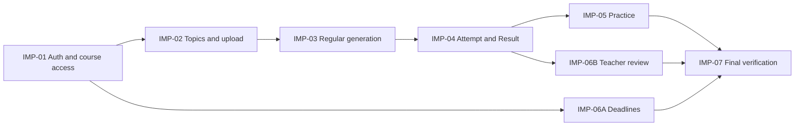

# AD-04 Phase 1 Implementation Plan

| Document control | Value |
| --- | --- |
| Version | 1.0 |
| Date | 2026-11-18 |
| Status | **Prepared for Review** |
| Scope | Documentation and implementation planning only; no IMP work started |
| Repository inspected | `main` at `144b13f`, clean before AD-04 edits |
| Sources | [Baseline v1.2](REQUIREMENTS_BASELINE.md), [traceability](REQUIREMENTS_TRACEABILITY.md), [AD-01 components](COMPONENT_ARCHITECTURE.md), [AD-02 data](DATA_MODEL.md), [AD-03 contract](API_CONTRACT.md), [architecture plan](ARCHITECTURE_PLAN.md), [README](../README.md) |
| Review boundary | Two supplied decisions below are Confirmed. Task decomposition, file layout, interfaces and technical options are recommended proposals; no formal team approval or runtime success is asserted. |

## 1. Confirmed decisions and delivery strategy

| ID | Status | Decision |
| --- | --- | --- |
| AD04-D01 | Confirmed | Incremental Vertical Slices: small independently verifiable increments integrate existing React UI, API/state layer, Express domain/API, Atlas/protected files and appropriate tests where applicable. Foundation-only subtasks are allowed, but route handlers alone do not complete a user-facing slice. Do not build the entire backend before frontend integration. |
| AD04-D02 | Confirmed | Dual Adapter + Incremental Migration: preserve the React/Vite Prototype and Demo Service; add a separate real API client and async-aware state layer, migrating workflows progressively. Handle async requests, loading/errors/retries, session initialization/expiry, real course authorization, drafts, navigation/refresh and data-shape differences. Isolate Demo from trusted authentication/authorization/grading/persistence; real mode must not trust LocalStorage fixtures as User, CourseMembership, Result or grade records. Exact interfaces, mode selection and state management remain proposals requiring review. |

The confirmed Phase 1 direction is React/Vite, one Node.js/Express modular monolith,
MongoDB Atlas, protected local server file bytes, backend-managed predefined Question Bank,
server-side Session with HttpOnly cookie, trusted membership provisioning and backend
course/ownership checks. AD03-D01 through D10 remain authoritative for sessions, CSRF/Origin,
synchronous uploads, operation replay, Start-time Attempts, Regular-only practice, course
IANA calendars, revisions and errors. No Python, Whisper, LLM, AutoNote or external AI is
required for startup or core workflows. Bank matching does not understand lecture contents.

**Proposed delivery rule:** finish the frontend integration and exit evidence for one slice
before declaring it delivered. Foundation tasks produce explicitly limited evidence, not
partial claims of full-stack completion. No people, delivery dates or time estimates are
assigned. Blocking choices in section 5 must be reviewed before the affected code starts.
All tests and implementation paths below are future work unless explicitly called existing.

## 2. Inspected implementation realities and frontend migration

| Existing path / evidence | Observed assumption | Migration implication |
| --- | --- | --- |
| [package.json](../client/package.json) | React/Vite scripts and Demo tests; no Express/Atlas backend dependencies or server scripts | Backend structure/config/scripts require scoped future additions; none exist by virtue of AD documents |
| [src/App.jsx](../client/src/App.jsx) | `useDemo()`, synchronous `session()` and render-time try/catch access/resource reads; uses `current.id` after choosing an assigned course | Explicit async session/loading/error/unauthenticated/no-course states; do not dereference a nonexistent course for a newly registered Student |
| [src/state/Demo.jsx](../client/src/state/Demo.jsx) | Module-level `createDemo(window.localStorage)`, `useSyncExternalStore`, storage events and timer-based refresh | Keep Demo provider separate; real mode needs async query/state lifecycle, not promises inserted into sync selectors |
| [src/services/demo.js](../client/src/services/demo.js) | Synchronous local save/notify; upload stores metadata; generation allocates Quiz and Attempt together; grading reads fixtures | Real API is server-authoritative; generation creates no Attempt, Start does; never reuse client grading or simulated storage as persistence |
| [src/data/fixtures.js](../client/src/data/fixtures.js) | Fictional users/memberships, browser-local date comparisons, five regular and two practice questions per Topic | No production identity source; real bank must support ten questions for a single selected Topic; course calendar comes from backend |
| [Materials.jsx](../client/src/screens/Materials.jsx) | Direct fixture import, synchronous upload/generate and simulated timer; no manual Topic selector | Add real topic selection/bytes/status/recovery branch; distinguish stored from eligible and preserve Demo behavior |
| [Quizzes.jsx](../client/src/screens/Quizzes.jsx) | Render-time Quiz/Result reads; `quiz.attempt.answers` assumed present, immediate save/submit and navigation; fixture option indexes and `rows/missed` feedback | Async preview before Attempt, explicit Start, local pending answers, snapshot/option IDs, revision conflicts and acknowledged navigation |
| [Dashboard.jsx](../client/src/screens/Dashboard.jsx), [Deadlines.jsx](../client/src/screens/Deadlines.jsx) | Render-time list calls; synchronous management and embedded submitted answer detail | Independently load panels, handle unavailable workflows during migration, invalidate/refetch after mutations; course-local date DTOs |
| [tests/services.test.js](../client/tests/services.test.js), [tests/browser.mjs](../client/tests/browser.mjs) | Demo service assertions, localStorage inspection, role switching and simulated interruption | Preserve as Demo regressions; add separate future real API/Atlas/browser suites with persisted-state assertions, never relabel Demo tests as backend evidence |

Preserve `/c/:course`, existing screen paths, UI-01 through UI-08 and UI-01T where compatible.
Authentication screens are supporting new UI, not invented original milestone screen IDs.
AutoNote stays outside the Phase 1 runtime. The original M2/M3 audit is not repeated here.

### Proposed async migration sequence

1. Establish separate API client and real-mode session context, proposed
   `client/src/services/api.js` and `client/src/state/Api.jsx`. Review an adapter boundary before editing
   screens; retain `client/src/services/demo.js` and `client/src/state/Demo.jsx` unchanged where possible.
2. Integrate login/logout, `/auth/me`, CSRF initialization and assigned Course selection.
   Real-mode route guards resolve loading/401/403/concealed 404/no-course states before
   rendering resource views. Preserve return navigation only after authorization.
3. Migrate Material/Topic views with async lists, real multipart bytes, advisory eligibility
   and safe upload-operation recovery; keep the same operation identity on uncertain retry.
4. Migrate generation/preview with server DTOs and Start as an explicit write. Do not wrap
   existing sync methods and assume render-time try/catch can catch rejected promises.
5. Migrate Attempts/Drafts/Results: separate last acknowledged revision from visible pending
   answers, reconcile conflicts, submit all visible answers, preserve same-session unsent
   choices, and recover ambiguous commits before navigating to Result.
6. Migrate Practice using Regular source links and the shared Start/answer/submit views.
7. Integrate Deadline and Teacher panels progressively. Deadline work may run earlier after
   IMP-01; this presentation sequence does not impose a Quiz dependency on IMP-06A.
8. Verify real-mode completeness before proposing retirement of any obsolete Demo behavior;
   no deletion of Demo is authorized by this plan.

**Recommended state behavior:** cache/read state is synchronous to rendering but hydrated
asynchronously; distinguish idle/loading/success/empty/error, mutation pending and unknown
outcome. Cancel or discard stale responses when course, resource, session or mode changes.
Use separate cache keys by authenticated identity/offering/resource; clear private caches
on logout/session change. Do not lose pending answers merely because a fetch times out.
Refresh/deep links refetch authorized resources, not local fictional records. Map API IDs,
`kind`, `dueDate`, snapshot options and `feedback` to reviewed view models instead of assuming
Demo's `id`, `Lecture`, `date`, option indexes or `rows` are API DTOs.

**Mode safety:** selection/configuration mechanism is Open (G-04). Recommend distinct Demo
and real composition roots; real root must not initialize Demo's module-level localStorage
service or import its identity/grading fixtures as fallback. Demo controls are isolated and
clearly labeled; production real users cannot select a fictional persona to grant rights.
A dev mode flag never changes backend authorization. No silent fallback to Demo on 401,
network failure or empty courses. During rollout, real-mode unintegrated panels show a
clear unavailable state rather than fabricated data. Any local recovery storage contains
only permitted pending choices, isolated by user/Attempt and cleared/reconciled under the
reviewed policy; it is never a trusted Result, membership or grade store.

## 3. Dependency map and sequencing

Edges are delivery prerequisites, not permission to skip IMP-01 access checks in later slices.
IMP-07 depends transitively on IMP-01 through IMP-06; verification preparation may begin
early, but final exit requires every included workflow integrated. IMP-06 is a grouping,
not a barrier requiring Deadlines to wait for grading.

| Increment | Delivery prerequisite | Work that can proceed independently after prerequisites | Exit evidence |
| --- | --- | --- | --- |
| IMP-01 | Reviewed foundation gates G-01–G-04, relevant DTO/config decisions | No authenticated business slice can ship first | Real login/logout, assignment-filtered navigation and browser refresh, not handlers alone |
| IMP-02 | IMP-01 | IMP-06A | Real upload, persisted metadata/bytes and later authorized retrieval through UI |
| IMP-03 | IMP-02 | IMP-06A | Ten-item safe persisted preview in existing lecture workflow, no Attempt |
| IMP-04 | IMP-03 | IMP-06A; finalization capability preparation can begin without shipping results | Real Start/draft/recovery and one immutable submitted Result |
| IMP-05 | IMP-04 | IMP-06A and IMP-06B | Separate practice lifecycle with unchanged original records |
| IMP-06A | IMP-01 only | IMP-02/03/04/05 and later IMP-06B | Teacher date changes reflected in both Student views |
| IMP-06B | IMP-04 (includes IMP-01 transitively) | IMP-05 and IMP-06A | Assigned Teacher sees submitted answers only |
| IMP-07 | IMP-05, IMP-06A, IMP-06B and all transitive predecessors | Evidence collection may run per slice; final gate waits for all | Complete AC/NFV evidence register with honest unmet conditions |

## 4. Small future Codex tasks

Every task below is **Proposed / not started**. Existing paths are actual files; `server/src/`,
`client/src/services/api.js`, `client/src/state/Api.jsx`, `client/src/screens/Auth.jsx`, `server/tests/api/`,
`server/tests/integration/` and `client/tests/api-browser.mjs` are **proposed new paths**, not created files.
Choose exact layout/interface at the relevant gate; avoid moving the existing frontend.
The common Definition of Done in section 7 applies to **each** task. Each task's exit below
adds its specific acceptance criteria. Each Git boundary means a separate human review,
no automatic commit/push unless that future task explicitly authorizes it, and stop before
starting the next ID. Failure/recovery checks are mandatory, not optional follow-up work.

### IMP-01 — Backend Foundation, Authentication and Course Access

**IMP-01A — Foundation and validated local configuration (foundation-only)**

- Goal/dependencies: establish runnable Express/config/Atlas adapter skeleton after G-01/G-02/G-04 interface and G-14 local deployment decisions; no auth or domain slice claim.
- Proposed files: new `server/` entry/config/persistence boundary and foundation checks; scoped `client/package.json`, lockfile and `client/vite.config.js` dev-proxy changes; documentation and placeholder-only environment example.
- Owners/data/operations: C02/C09, User/Course/CourseMembership storage boundary only; internal health/config diagnostics are proposed, not extra business endpoints or public admin APIs.
- Behavior: validate required config without printing secrets, explicit startup/shutdown/errors, same-origin dev routing and protected storage location plan; no importing AutoNote.
- Tests/exit/DoD: future automated config tests reject missing/malformed settings; authorized nonproduction Atlas connection smoke/restart/close evidence and Vite/API proxy check. Bad credentials/unavailable DB fail clearly without secret logs; Demo still launches independently. This task may connect only when a future implementation task authorizes it.
- Git review boundary: foundation/config/dependency additions only; no models, auth endpoints, provisioning or business UI in this unit. Record limits; pass common DoD.

**IMP-01B — Trusted identities, provisioning and protected auth/course APIs (foundation-only)**

- Goal/dependencies: IMP-01A; settle G-01/G-02/G-03 and relevant G-13 schemas. Build authenticated service capacity, not a completed user-facing slice.
- Proposed files: `server/` identity/policy/session/auth/course modules, trusted fictional provisioning and `server/tests/api/`, `server/tests/integration/`; no public provisioning routes.
- Owners/entities/endpoints: C02/C09; User, Course, CourseMembership; AD-03 register/login/me/logout/csrf and Course list/detail operations.
- Behavior: secure password hashes, persistent server sessions, reviewed cookie/CSRF/Origin controls including auth actions; public Student has no assignments, trusted script provisions Teacher/offerings/memberships idempotently without embedded credentials. Backend role+membership checks precede data exposure.
- Tests/exit/DoD: repeat provisioning yields no duplicates or destructive resets; real API tests cover Student registration with zero courses, forged roles/membership, trusted Teacher, invalid login, two same-code offerings, unauthorized direct course access, session restart/refresh, logout revocation and absent/invalid CSRF/Origin. Lost auth responses recover through session state; provisioning failure can be rerun safely. Persistence evidence uses scoped test data, not Demo.
- Git review boundary: auth/provisioning/course service plus focused tests/config docs; leave user-facing delivery open until IMP-01C. No Topic bank or uploads.

**IMP-01C — Real API adapter, session UI and authorized course navigation**

- Goal/dependencies: IMP-01B and G-04; finish the first vertical slice.
- Proposed files: new API client/state/Auth screen, scoped `client/src/main.jsx`, `client/src/App.jsx`, shared components and API browser tests; preserve Demo provider/service and existing routes.
- Owners/entities/endpoints: C01/C02/C09; User/Course/CourseMembership; all IMP-01B operations, no extra original US/UI IDs.
- Behavior: login, registration/logout, async initialization/expiry, CSRF refresh, assigned-course chooser, empty-course page and access errors; no `current.id` crash or local fixture fallback. Hide unfinished real business panels rather than calling Demo.
- Tests/exit/DoD: browser registration shows no course access; provisioned users navigate only authorized courses; refresh/deep link/expired session/logout-relogin work; stale prior-user fetches never display. Test CSRF rejection, network failure, pending indicators, keyboard login and Demo/real isolation. Real user cannot invoke role switcher/reset as backend privilege.
- Git review boundary: adapter/session/navigation integration only; report real full-stack evidence and unchanged Demo regression results. IMP-01 exits only after this unit passes.

### IMP-02 — Course Topics and Material Upload

**IMP-02A — Protected bytes/metadata and recoverable upload APIs (foundation-only)**

- Goal/dependencies: IMP-01C; resolve G-05/G-06 and material DTOs in G-13.
- Proposed files: `server/` materials/topics/file adapter/operation coordinator, future `server/tests/api/` and cross-store failure tests; protected storage outside public assets.
- Owners/entities/endpoints: C02/C03/C09/C10; Topic, LectureMaterial, Course/membership; the five AD-03 material list/upload/detail/file/upload-operation routes plus Topic list.
- Behavior: validate all selected Topics (at least one), actual format/nonempty bytes/limits, server-owned file key and metadata; synchronous success only when both stores associate. Guard file reads. Upload identity/fingerprint and unknown-outcome recovery prevent duplicate valid materials; no mandatory background job architecture.
- Tests/exit/DoD: upload/retrieve actual supported bytes and compare integrity after restart; metadata survives. Inject disk/DB failures, crash windows, orphan bytes, foreign/mixed/empty Topics, unsupported/oversize/empty files, disconnection and lost response. Reconciliation neither deletes active uploads nor reports false stored state. Bank shortage leaves a valid upload intact.
- Git review boundary: material/file APIs and operational recovery tests only; user-facing slice stays open until IMP-02B.

**IMP-02B — React Topic selection and real Material workflow**

- Goal/dependencies: IMP-02A; integrate upload/list/detail/retrieval in existing UI-01/02/03.
- Proposed files: scoped `client/src/screens/Materials.jsx`, `Dashboard.jsx`, API client/state and real-browser checks; direct fixture imports stay Demo-only.
- Owners/entities/endpoints: C01/C03/C10 with C02/C09; LectureMaterial/Topic/Course; Topic and all material operations from IMP-02A.
- Behavior: select one/many Topics, multipart real bytes, clear pending/error/stored versus eligibility feedback; no simulated readiness timer in real mode. Preserve operation identity across interrupted/ambiguous response; reauthenticate before authorized recovery.
- Tests/exit/DoD: browser selects supported file/Topics, stores then refreshes and downloads identical bytes in a later authenticated session. Verify invalid associations/backend failures, interrupted upload, lost-success recovery with one material, inaccessible foreign file and insufficient bank. Keyboard upload/native chooser follow-up is recorded separately from injected browser file selection.
- Git review boundary: only Material UI/state/client and focused integration tests; no generation implementation. IMP-02 exits after real byte retrieval and common DoD.

### IMP-03 — Question Bank and Regular Quiz Generation

**IMP-03A — Trusted bank capacity and deterministic candidate provider (foundation-only)**

- Goal/dependencies: IMP-02B for the increment; resolve G-07/G-08, generation identity aspects of G-06. Prepare bank and selection without claiming delivered preview.
- Proposed files: trusted `server/` content provisioning, C05 candidate provider, focused provider/integration test data in proposed test directories; do not repurpose browser fixtures as production truth.
- Owners/entities/endpoints: C05/C09 with C04 review; Course/Topic/Question; internal provider, no public Question/Topic CRUD endpoint.
- Behavior: stable Question IDs/revisions, retired versus active items, offering isolation, dedup before count, reviewed Topic-balanced choice and empty-Topic compensation. Trusted seed is repeatable and credential-free.
- Tests/exit/DoD: pools of 9/10/11 unique candidates, duplicate/multi-tag IDs counted once, two offerings with same code, retired items and empty Topic compensation. Prepare at least ten eligible regular questions on a single Topic plus source-excluded practice alternatives. Reject invalid bank revisions/foreign tags and recover provisioning without duplicating IDs.
- Git review boundary: bank/provider preparation only; no client bank/key exposure or Attempt writes.

**IMP-03B — Idempotent generation, immutable preview and React integration**

- Goal/dependencies: IMP-03A; reviewed generation DTO/error/projection and operation retention policy.
- Proposed files: `server/` C04 Quiz creation/projection, scoped Materials/API state and browser tests.
- Owners/entities/endpoints: C01/C04/C05/C09, C03 context/C02 access; Question/Quiz/LectureMaterial/Topic; regular generation POST, Quiz GET and own Quiz index GET in AD-03.
- Behavior: persist exactly ten distinct snapshots, favor chosen Topics, safe preview before Start; no Attempt/Result at generation. Same operation returns same Quiz, new deliberate operation makes another, conflicting key never mutates it. Missing coverage creates no partial Quiz or invalid material.
- Tests/exit/DoD: browser generates from real single-Topic material and reloads persisted preview; 9 fails/10 and 11 yield ten; assert DB has zero Attempts/Results, no correct keys/unreleased explanations in any pre-submit response. Test concurrent/replayed/conflicting operation IDs, bank edits leaving snapshots stable, definite/unknown persistence outcomes and authorization denial.
- Git review boundary: generation/preview vertical slice only; Start may remain explicitly unavailable until IMP-04A, never create Demo draft as fallback.

### IMP-04 — Attempt, Draft, Submission and Result

**IMP-04A — Start, conditional Draft saves and async recovery**

- Goal/dependencies: IMP-03B; resolve G-09 and sole-Attempt uniqueness aspects of G-10 before creation code.
- Proposed files: `server/` C06 start/draft/read and persistence validation, `client/src/screens/Quizzes.jsx`, scoped preview Start control in Materials, API client/state and focused real tests.
- Owners/entities/endpoints: C01/C02/C06/C09; Quiz/Attempt; POST Quiz attempts, GET Attempt and PUT Draft from AD-03, safe Quiz reads.
- Behavior: Start creates the sole Draft, replay recovers it, preview alone creates none; full-answer draft replacement with expected revision, valid snapshot/option IDs, stale writes rejected. Keep visible unsynchronized choices separate from acknowledged answers/revision; no silent last-write-wins or grade.
- Tests/exit/DoD: concurrent Start yields one persisted Attempt; concurrent Save and duplicate stale Save cannot overwrite; invalid IDs/incomplete draft allowed only as valid partial choices; refresh recovers acknowledged draft. Real browser network loss retains unsent choices, course/user switches isolate them, session expiry requires reauth, stale fetches do not erase edits. Submitted-state fixtures cannot reopen; final submit remains unavailable until IMP-04C.
- Git review boundary: real Start/draft vertical unit only, no grading/Result creation; complete common DoD with its own UI recovery evidence.

**IMP-04B — Validate finalization capabilities and persistence strategy (foundation-only)**

- Goal/dependencies: IMP-04A; G-10 reviewed before implementing the finalization mechanism. Verify proposed unique Attempt.quizId and Result.attemptId constraints, Atlas transaction support and unknown-commit handling in the authorized nonproduction deployment.
- Proposed files: narrowly scoped `server/` persistence/validation support, future `server/tests/integration/` capability/concurrency probes and test setup documentation; no production migrations or credentials.
- Owners/entities/endpoints: C06/C09 with C02 access; Quiz/Attempt/Result; validates prerequisites for Submit and Attempt-result recovery, not a new public operation.
- Behavior: record chosen topology/driver/session/read-write/commit retry strategy, index duplicate behavior, partial-write prevention and membership-revocation assumptions. Side effects outside transactions cannot be rolled back by Atlas; no file operations in retry callbacks.
- Tests/exit/DoD: actual deployment capability evidence, duplicate uniqueness checks, verified abort versus committed/unknown outcome and safe retry/reconciliation. If capabilities/permissions are unavailable, report gate blocked and do not implement unsafe two-write finalization. Demo/local fake transactions are not Atlas evidence.
- Git review boundary: capability/strategy support only; no submitted-result delivery claim. Any test database mutations require the future task's explicit scoped environment authorization.

**IMP-04C — Final Submit, snapshot grading and Result UI**

- Goal/dependencies: IMP-04B passes and G-10 decision is recorded; finalize relevant G-13 submission/replay DTOs.
- Proposed files: `server/` C06 finalization/result reads, scoped `Quizzes.jsx`, `Dashboard.jsx`, API state and future integration/browser tests.
- Owners/entities/endpoints: C01/C02/C06/C09; Quiz/Attempt/Result; POST Submit, GET Attempt-result, GET Result, GET own Results and own Quizzes index.
- Behavior: complete visible answer set plus expected revision; reject incomplete/invalid answers without losing choices. Server grades preserved Quiz snapshot, commits final answers/state/one Result consistently, never reopens/overwrites. Identical finalized retry returns same Result; changed-answer replay cannot change grade. New learning requires new Quiz.
- Tests/exit/DoD: concurrent Submit, Save-versus-Submit, duplicate/changed-answer replay, unanswered items, DB abort, lost committed response and unknown commit. Recover by Attempt/Result without new IDs; inspect exactly one Result and immutable timestamps/history. Browser shows persisted score/corrections after refresh; edited/retired bank does not alter historical grade. Reconnect retains unsent answers and distinguishes saved/unknown state.
- Git review boundary: finalization/Result integration only; no practice yet. IMP-04 exits only after both draft and finalization units provide real persisted/browser evidence.

### IMP-05 — Targeted Practice

**IMP-05A — Independent Regular-source practice through the existing UI**

- Goal/dependencies: IMP-04C; resolve G-11 sizing/repeated-intentional-practice and cross-practice exclusion policy before enabling repeated generation, plus G-06 practice identity scope.
- Proposed files: `server/` C04 practice orchestration using C05/C06, scoped `Quizzes.jsx`, API state and focused tests; reuse Start/draft/finalization, not duplicate grading logic.
- Owners/entities/endpoints: C01/C02/C04/C05/C06/C09; source Regular Result/Quiz, Topic/Question, new practice Quiz/Attempt/Result; POST Result practice-quizzes and existing Quiz/Attempt/Result operations.
- Behavior: only owned submitted Regular source; derive weak Topics from frozen feedback; exclude every originalQuestionId in source Quiz including correct answers and revised bank versions. Select reviewed 1-10 distinct candidates, never more than pool; perfect/zero produce no records. No recursive practice.
- Tests/exit/DoD: candidate pools 0/1/9/10/11, perfect source, Practice Result source denial, other Student/course denial, stable exclusions after bank edits, replay/conflicting keys, definite/unknown generation outcomes. Browser preview/Start/submit/new Result and return-to-original work. Compare entire original Quiz/Attempt/answers/Result/score before/after including failures; own practice Result remains reviewable.
- Git review boundary: practice vertical slice only; unresolved repeat policy must be reported, never filled with an invented confirmed limit. Exit requires real independent history, not merely a link to original Result.

### IMP-06 — Deadlines and Teacher Review

**IMP-06A — Date-only course calendar and Teacher management**

- Goal/dependencies: IMP-01C only; resolve G-12 and deadline fields/edit/delete semantics in G-13. Can run before IMP-02/03/04; does not depend on Quiz or grading.
- Proposed files: `server/` C07 date/write/projection modules, `client/src/screens/Deadlines.jsx`, relevant Dashboard panel and API state/tests; protect unrelated unfinished panels from Demo fallback.
- Owners/entities/endpoints: C01/C02/C07/C09; Deadline/Course/User/CourseMembership; course Deadline GET/POST/PATCH/DELETE.
- Behavior: assigned Teacher CRUD with title/type/real YYYY-MM-DD validation, past management allowed; backend derives today in trusted per-offering IANA zone. Students see today/future, day 0 through +7 Upcoming, +8 unmarked, past hidden; no stored Alerts. Refresh both views after edit/delete/day rollover.
- Tests/exit/DoD: Teacher UI write persists across reload/restart; Student writes and unassigned requests denied; forged author/course cannot change rights. Check invalid/leap dates, 0/+7/+8/past, zones differing from browser, DST/day rollover, missing zone and two same-code offerings. Failed/unknown mutation response must reconcile current course state before retry; no stale badges or resurrected deleted item. Real browser and API state agree.
- Git review boundary: Deadline slice only; no Result schema/query dependency. Preserve Demo date demonstration; do not declare original security NFR passed from Demo guards.

**IMP-06B — Assigned Teacher submitted Result inspection**

- Goal/dependencies: IMP-04C (IMP-01C transitively); list/detail paging and safe Teacher DTO choices in G-13. Independent of IMP-05 and IMP-06A.
- Proposed files: `server/` C08 read projection via C06, scoped `Dashboard.jsx` UI-01T, API state and access/browser tests.
- Owners/entities/endpoints: C01/C02/C08 through C06/C09; CourseMembership/User/Course, saved Quiz/Attempt/Result; GET course Results and course Result detail.
- Behavior: only assigned Teacher sees submitted scores/answers, including submitted practice when present; exclude Drafts and concealed foreign resources. No Teacher mutation or regrading. Summaries/details loaded asynchronously with consistent authorization.
- Tests/exit/DoD: assigned Teacher expands persisted submission, refreshes; drafts excluded, two offerings/other Teacher/Student direct-read denial tested. Minimal student identity only; no session/hash/private bank leakage. Revocation/expired session/network errors clear inappropriate cached detail; bank changes do not change review.
- Git review boundary: Teacher read-only slice and focused tests. An independent fixture setup can test submitted practice without depending on IMP-05 delivery; final IMP-07 verifies live generated practice too.

### IMP-07 — Integration, Regression and NFR Verification

**IMP-07A — Integrated real workflows and failure regression**

- Goal/dependencies: IMP-05A, IMP-06A and IMP-06B; all transitive prerequisites delivered. Test preparation can begin earlier, final acceptance cannot.
- Proposed files: separate `server/tests/api/`, `server/tests/integration/`, `client/tests/api-browser.mjs`, scoped test scripts/config and evidence documentation. Application fixes require a small explicitly scoped follow-up task, not an unbounded test cleanup.
- Owners/entities/endpoints: C01–C10, all ten AD-02 entities, all 30 proposed AD-03 operations; trace table and section 6 define coverage.
- Behavior/evidence: real Student/Teacher upload/generate/preview/Start/draft/submit/practice/calendar/review with AI/Python absent, restart/refresh, deep links, logout/CSRF, course ownership, real bytes and Atlas, concurrent writes, unknown outcomes and historical preservation.
- Tests/exit/DoD: all included AC-01 through AC-14 have persisted-state assertions and browser outcomes; run separate existing Demo regressions, real API/Atlas cases and real UI suite with no fixture authentication fallback. Cover definite versus unknown persistence failures, restore/recovery and stale cross-user responses; failures stay open in the evidence register rather than being waived.
- Git review boundary: verification tooling/evidence only within assigned scope; report environment, revision and results. Functional completion requires IMP-07B's applicable evidence too.

**IMP-07B — Manual acceptance and original NFR evidence**

- Goal/dependencies: IMP-07A plus reviewed NFR protocols, authorized fictional datasets and participant/environment preparation. Can design protocols earlier without collecting invalid benchmark evidence.
- Proposed files: evidence/protocol documentation and narrowly scoped future measurement tooling; no new feature scope.
- Owners/entities/endpoints: C01 with C02–C10 as applicable; all workflow data, generation/Result reads and interrupted Submit; NFV-01 through NFV-06.
- Tests/exit/DoD: collect automated timing/security/recovery evidence where meaningful, manual keyboard/native chooser walkthrough and five-user usability study separately. Record actual revision/environment/dataset, results and unmet conditions. Phase 1 bank timing cannot close AI-dependent NFR-01; record pending applicability/requirements decision without changing the target. No production-security certification is inferred.
- Failure/recovery: repeat invalid measurements only after correcting protocol; preserve negative findings and actual reconnect/restore failures. A missing participant study/AI precondition remains explicitly unverified, never marked passed by mock equivalence.
- Git review boundary: evidence only, no feature expansion or invented requirement waivers; final review reports remaining blockers before Phase 1 acceptance.

## 5. Blocking decision register

All statuses below are Open or Proposed; recommended options are evaluation candidates,
not approved libraries, schema designs or implementation commands. Decide only the gates
needed by the next small task; deferred gates must be resolved before their first affected
unit. A documented decision must include authority, tradeoff, affected contract and tests.

| Gate / status | Question and AD-03 reference | First affected IMP | Recommended options / evaluation criteria | Risk and required decision before code |
| --- | --- | --- | --- | --- |
| G-01 Open | Session library/persistent store, lifetime and password hashing; AD03-D01/D02, auth section 4 | IMP-01A config; IMP-01B auth | Review maintained Express-compatible server session options, persistent store/revocation, secure salted hashing cost, expiry/rotation; no JWT primary alternative | Auth scaffolding needs config boundaries; identity code waits for explicit store/hash/lifetime choice, no production memory-only session assumption |
| G-02 Open | CSRF, cookie, Origin/proxy configuration; AD03-D09 | IMP-01A dev routing; IMP-01B protection | Session-bound token bootstrap/rotation, exact same-origin allowlist, HTTPS/dev cookie rules, proxy trust; reject missing/invalid Origin per reviewed contract | Wrong defaults break auth or permit forgery; settle security transport before writes, including login/logout/register |
| G-03 Proposed | Trusted idempotent provisioning mechanics; AD03-D02 | IMP-01B | Candidate rerunnable script with stable offering/user keys, non-destructive repeat behavior, fictional dataset and injected secrets | Duplicate or escalating assignments; approve scope, association and credential injection before script execution |
| G-04 Open | Dual-adapter boundary, async state and Demo/real selection; AD04-D02, AD-03 conventions | IMP-01A interface/proxy assumptions; IMP-01C frontend | Compare focused context/hooks versus reviewed query-state approach; separate composition roots, DTO view models and identity-scoped caches | Sync render failures or fictional privilege fallback; review interface/mode isolation before integration, never implicit adapter auto-fallback |
| G-05 Open | Upload numeric limits, actual byte validation, staging/recovery/backups; AD03-D03, upload section 7 | IMP-02A | Bound streaming/size/type validation; controlled paths, correlation, durable completion, cleanup/restore protocol | False success, orphan/lost bytes; decide limits and failure/reconciliation order before accepting files |
| G-06 Open | Upload/generation identity fingerprints, lifetime, replay/expiry and unknown outcomes; AD03-D04/D10 | IMP-02A upload; IMP-03B generation; IMP-05A practice | Review header/namespace, authorized context, canonical inputs, immutable operation-to-resource association, retention and collision/error handling | Duplicate resources on timeout/expiry; approve upload scheme before IMP-02A and generation scheme before IMP-03B; no automatic new identity |
| G-07 Proposed | Topic-balanced selection/reproducibility; AD02-D04, AD-03 sections 7/8 | IMP-03A | Evaluate AD-02 round-robin candidate policy, overlap dedup, empty-topic compensation, stable ordering/tie/version semantics | Unpredictable coverage or partial quizzes; record exact algorithm and boundary datasets before provider code |
| G-08 Open | Bank capacity, stable identity/revisions, tags/usage/retirement; AD-03 snapshot/practice rules | IMP-03A | At least ten regular candidates per demonstrated single Topic; practice alternatives after source exclusions; immutable lineage and repeatable provisioning | Five-per-Topic Demo pool cannot satisfy single-Topic regular rule; approve real dataset/version/maintenance policy without editing Demo as a shortcut |
| G-09 Open | Autosave interval, local unsynced recovery, conflict UI; AD03-D08, section 6 | IMP-04A | Serialize/coordinate saves with expected revisions, visible pending state, user-isolated temporary recovery and explicit merge/retry UX | Lost choices or stale overwrites; choose acknowledgment/conflict behavior before draft integration, no last-write-wins |
| G-10 Proposed | Atlas transactions, uniqueness, commit retry/reconciliation; AD-02 section 9, AD-03 section 6 | IMP-04A sole-Attempt constraint; IMP-04B capability proof; IMP-04C finalization | Review unique Attempt.quizId/Result.attemptId and transaction strategy against actual topology/driver; specify unknown commit and revocation races | Duplicate Attempt/Result or submitted-without-Result; settle Start uniqueness before IMP-04A and validate chosen atomic strategy before IMP-04C |
| G-11 Open | Practice size, repeated intentional generation, cross-practice reuse; AD03-D06 | IMP-05A | Compare bounded `min(10,pool)` sizing and explicit repeated-request policy, preserving same-operation replay and Regular-only source | Accidental entitlement/recursive practice or impossible selection; record sizing/repeat policy before enabling repeated operations |
| G-12 Open | Offering IANA configuration, date range/rollover/timezone changes; AD03-D07 | IMP-01B provisioning field; IMP-06A calendar behavior | Trusted per-offering zone, backend calendar-day arithmetic, refresh/invalidation on rollover; America/New_York only illustrative | Wrong day/badge across clients; provision valid zone before course setup, settle rollover policy before calendar slice |
| G-13 Open | Pagination/filtering, precise DTO/error/status validation and edit/delete semantics; AD-03 sections 2/5/10 | IMP-01B then each endpoint-owning unit | Allowlisted bounded queries, safe projections, concealed resources, stable DTO mapping; review each slice contract before coding | Client/server mismatch or data exposure; freeze necessary fields/statuses per slice rather than defer all schemas to final integration |
| G-14 Open | Local deployment/config, future data migration, backup/restore and operational isolation; AD-03 handoff | IMP-01A config; IMP-02A files; IMP-07 recovery evidence | Keep frontend in place; choose server layout/commands/test DB/storage root, secret injection and coordinated Atlas/file backup; no automatic Demo-to-real import | Environment mistakes, leaked secrets or broken history; decide local/test boundaries first, migration/retention/restore strategy before affected writes/rollout |

IMP-01 blockers are G-01/G-02/G-04/G-14 foundation aspects, then G-03/G-13 identity contracts
and G-12 provisioning zone. Detailed selection, drafts, finalization and practice decisions
can wait for their listed increments. Trusted fields' representation and migration/index
rollout remain review choices, not a mandate to run schema changes in this task.

## 6. Verification and requirements traceability

This plan preserves the [baseline acceptance criteria](REQUIREMENTS_BASELINE.md#proposed-acceptance-criteria)
and original identifiers/conditions. The matrix is a future evidence allocation, not test
results. Security/course ownership (AC-11), AI independence (AC-12), frontend preservation
(AC-13) and automated critical failures (AC-14) apply throughout each relevant slice, not
only at the final gate. US-07 is retained without inventing a sixth critical use case.

| IMP | FRs / original UC and US scope | ACs / relevant NFR verification | AD-01 components | AD-02 entities | AD-03 operations |
| --- | --- | --- | --- | --- | --- |
| IMP-01 | FR-01, supports all UC-01 through UC-05 and US-01 through US-07 | AC-01, AC-11/12/13/14; NFV-03; keyboard continuity NFV-05 | C01/C02/C09 | User, Course, CourseMembership | register/login/me/logout/csrf; Course list/detail |
| IMP-02 | FR-02; UC-01 / US-01 | AC-02/03, AC-11/12/13/14; contributes NFV-04/05 | C01/C02/C03/C09/C10 | LectureMaterial, Topic, Course, User, CourseMembership | Topic list; Material list/upload/detail/file and upload-operation read |
| IMP-03 | FR-03; UC-02 / US-02 | AC-04/05, AC-11/12/13/14; NFV-01 limitation, NFV-04/05 workflow | C01/C02/C03/C04/C05/C09 | Question, Topic, LectureMaterial, Quiz, Course, CourseMembership | regular generation, Quiz preview, own Quiz index |
| IMP-04 | FR-04; UC-03 / US-03 | AC-06, AC-11/12/13/14; NFV-02/03/04/05/06 | C01/C02/C06/C09 with C04 snapshots | Quiz, Attempt, Result, CourseMembership | Start, Attempt read, Draft PUT, Submit, Attempt-result read, Result read, own Results/Quizzes |
| IMP-05 | FR-05; UC-04 / US-04 | AC-07/08, AC-11/12/13/14; NFV-03/06 through reused lifecycle | C01/C02/C04/C05/C06/C09 | source Result/Quiz, Topic/Question, separate Quiz/Attempt/Result | Result practice-quizzes; normal Quiz/Attempt/Result operations |
| IMP-06A | FR-06; UC-05 / US-05 and US-06 | AC-09, AC-11/12/13/14; NFV-03 | C01/C02/C07/C09 | Deadline, Course, User, CourseMembership | Deadline GET/POST/PATCH/DELETE |
| IMP-06B | FR-07; US-07, no dedicated critical UC | AC-10, AC-11/12/13/14; NFV-02/03 | C01/C02/C08 via C06/C09 | CourseMembership/User/Course, submitted Result/Quiz/Attempt | course Result list/detail |
| IMP-07 | FR-01 through FR-07; UC-01 through UC-05; US-01 through US-07 | AC-01 through AC-14; NFV-01 through NFV-06, each with evidence limitations | C01 through C10 | All ten entities above, including Question/Topic and Deadline | All 30 AD-03 operations with real-role/ownership/failure coverage |

### Evidence types and final exit

- **Automated:** future provider/validation tests, real cookie/CSRF API tests, actual Atlas
  persistence/uniqueness/transaction tests, protected-byte integrity and separate browser
  workflows. Inspect committed state and counts after races/unknown responses, not merely
  HTTP codes. Use authorized fictional data and isolate/clean test resources safely.
- **Manual acceptance:** walk through all five original critical use cases and Teacher
  US-07, keyboard/native file chooser, navigation/refresh, failure recovery and operational
  backup/restore. Preserve before/after records for practice/history checks.
- **NFR measurements/studies:** use the exact protocols below; automated Demo regression
  cannot replace user studies, real network interruptions or representative timings.
- **Evidence register (proposed):** per check record requirement/scenario, implementation
  SHA, mode, browser/runtime, database topology/config without secrets, dataset, procedure,
  actual result/artifact and limitation. Status is planned/not run, passed, failed or blocked
  with a stated reason. At AD-04 creation, all new real-backend evidence is **not collected**.

| Original NFR / procedure | Required original conditions and planned evidence | Exit treatment |
| --- | --- | --- |
| NFR-01 / NFV-01 | Already processed lecture at most 30 slides; one active user and working AI service; at least 18 of 20 ten-question requests display within 30 seconds | Phase 1 predefined bank timing is separate diagnostic evidence, never compliance proof. Retain applicability/AI requirement decision as open; do not waive/change threshold or claim passed. |
| NFR-02 / NFV-02 | 100 saved results, one active user, standard desktop browser and stable campus Wi-Fi; at least 19 of 20 Result-page requests load within 3 seconds | Define timing boundaries/dataset and record real Student/Teacher page timings; no benchmark has been run here. |
| NFR-03 / NFV-03 | A real Student cannot create/change/delete course-wide deadlines or read another Student's private answers | API/direct-ID plus UI checks with real sessions; include assigned-Teacher isolation as FR-07/AC-10 coverage, not silently added original NFR wording. |
| NFR-04 / NFV-04 | Five first-time Students; at least four upload a supported slide file, generate a Quiz and submit unassisted within 10 minutes | Observe participants and record assistance/time; automation cannot close this study. |
| NFR-05 / NFV-05 | Upload, answering and submission keyboard-operable with visible focus using Tab/Shift+Tab/Enter/Space | Manual native chooser plus real UI checks; injected Playwright file selection is only partial evidence. |
| NFR-06 / NFV-06 | If submission fails because connection drops, selected answers remain visible upon reconnection during the same active session | Real disconnect before Submit and lost response after commit; verify unsent choice retention and same Result recovery, not a simulated error flag. |

IMP-07 exit requires all included workflows integrated, applicable AC evidence reviewed,
failed checks fixed/retested within scoped tasks, and unverified NFR conditions disclosed.
A reviewable implementation with an open NFR study is not a claim of full requirements
acceptance. No production security certification or performance result is asserted here.

## 7. Common Definition of Done and Git review workflow

Every future task must satisfy all applicable items; foundation-only scope must identify
which user-facing acceptance remains pending in its dependent slice.

1. Inspect current status, applicable AD documents and prerequisite evidence. Resolve the
   task's blocking gates under explicit review; do not treat this plan as blanket approval
   of mechanisms, external database access or follow-on work.
2. Keep code changes within assigned scope and preserve unrelated work. Any new paths,
   schemas, dependency choices or migrations are proposed until that implementation task
   reviews them. Do not move/rewrite the entire frontend to introduce a service boundary.
3. Run relevant focused automated tests; when a screen/client changes, run existing Demo
   regressions as appropriate plus the new real-mode cases. Report exact commands/results.
   Existing `npm test` and `npm run test:browser` target Demo, not Atlas. Build/browser
   prerequisites are setup work only when the future task requires them.
4. Verify real integration where required: actual session/backend authorization, Atlas
   records/restart, protected file bytes, network/retry/concurrency outcomes. Report any
   inaccessible environment as blocked evidence, not substituted mock success.
5. Cover normal flow and critical failure/recovery cases stated for the task. Enforce safe
   DTOs and private-data/course/ownership boundaries. No false success after ambiguous
   persistence; no historical mutation or duplicate resources on retry.
6. Preserve existing unrelated frontend paths, Demo workflows and keyboard behavior.
   Verify loading/errors, refresh/deep links, empty assignments, session expiry and pending
   answer retention where relevant. Real mode cannot use Demo as an authorization fallback.
7. Update focused documentation/config instructions and requirement evidence; report files,
   tests, failures and limitations honestly. Files created or Codex reporting success alone
   is insufficient evidence of done.
8. Inspect diff/scope and `git diff --check`; check secrets are not included. Keep production
   connection strings, session keys, real accounts/user data and recordings out of Git.
   Use environment-injected secrets and placeholder examples; never log secret values.
9. Stop for human review **before Git commit/push** and before the next task. Recommend a
   small commit per reviewed subtask or verified slice, but do not automatically stage,
   commit, push or deploy unless the specific future task authorizes it. Preserve history;
   do not reset/rebase unrelated commits to repair a failed task.

A task's exit is its stated acceptance plus this common DoD, with recorded human review.
A foundation unit may close its narrow scope while the parent slice stays undelivered;
a functional slice requires the actual React-to-backend-to-storage behavior and evidence.
No backend-first completion claim is allowed for UI-facing increments.

## 8. First implementation handoff and future prompt structure

**Recommended first task: IMP-01A — Foundation and validated local configuration.** It has
no prior IMP dependency, but foundation aspects of G-01/G-02/G-04/G-14 must be explicitly
resolved first: server layout/scripts/dependency policy, session/config boundary, same-origin
dev proxy/Origin assumptions, adapter isolation boundary, nonproduction Atlas/test-storage
access and secret injection. Auth-specific library/hash/expiry details must be settled by
IMP-01B; do not implement them implicitly in the skeleton. A read-only design/setup step
may settle missing choices before the authorized coding task starts.

Limit IMP-01A to reviewed Express startup/config/adapter scaffolding, graceful shutdown,
scoped local dev configuration and focused foundation checks. No models, business API,
accounts, provisioning, uploads, auth UI or frontend migration yet. This foundation exception
does not postpone all UI integration: IMP-01C closes the first real user-facing slice.
Acceptance needs missing/malformed-config tests, no secret disclosure, API/proxy startup
and authorized nonproduction Atlas connectivity/failure/shutdown evidence, while existing
Demo startup remains available. If access is not authorized/available, document the blocked
smoke check rather than connecting elsewhere or claiming the foundation is fully verified.

Suggested structure for each future Codex prompt (planning template only):

- **Task ID and goal:** exactly one unit, explicit user/business scope and non-goals.
- **Inputs/prerequisites:** relevant AD sections, prior task SHA/evidence, reviewed gate
  decisions; ask only for genuinely missing blocking facts while progressing independent work.
- **Allowed changes/environment:** existing/new paths, dependency limits, safe fictional
  test database/storage and permitted external operations; preserve unrelated edits.
- **Behavior and verification:** concrete success/failure/recovery/concurrency cases, API
  operations/DTOs, required persisted-state/browser evidence and expected test commands.
- **Exit/report:** task-specific acceptance plus common DoD, changed files/tests/limitations,
  stop before next task and human review before commit/push unless specifically authorized.

This handoff is not an instruction to begin IMP-01A. All IMP work remains future work.

## 9. Revision history

| Version / date | Change | Status |
| --- | --- | --- |
| 1.0 / 2026-11-18 | Task 7: two confirmed delivery decisions, dependency-aware small IMP units, async migration, blocking gates, traceability and future evidence/DoD | Prepared for Review; no IMP implementation or runtime evidence collected; no staging, commit or push |
